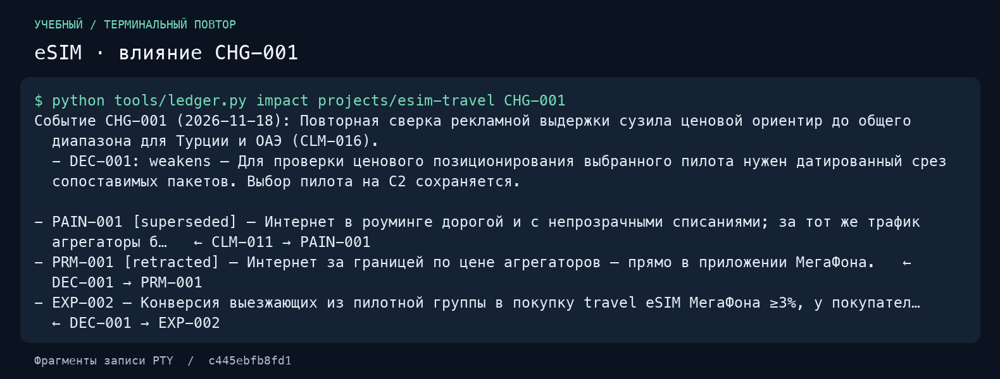

# Стратег Фабрики продуктов

Стратег помогает руководителю выбрать, во что вкладываться и что обещать клиенту. Папку открывают в агентной среде и задают вопрос обычными словами. На выходе руководитель получает варианты с возражениями, продуктовую и коммуникационную стратегии, план проверки и журнал решения. В готовом HTML-отчёте можно открыть основания вывода по его идентификатору. [Отчёт «Рядом»](../projects/ryadom/outputs/report.html)

**Ниже разобраны три учебных кейса.** Официальное ТЗ описывает агента и предусматривает отдельный демонстрационный бриф МегаФона. В этой версии такого брифа нет. Приведённые ниже примеры, видео и затраты относятся к репетициям. [Условия конкурса](TZ_OFFICIAL.md) · [Учебный видеообзор, 1 мин 35 с](../evals/score9/demonstration/walkthrough.mp4)

## Как принимается и пересматривается решение

1. Агент выделяет из запроса спорный выбор, аудиторию, цель и ограничения. Руководитель подтверждает рамку на **C1**. Затем агент составляет план исследования, собирает документы, таблицы и открытые веб-источники, выписывает проверяемые утверждения и указывает пробелы.
2. Агент сравнивает как минимум три варианта, включая сохранение текущего подхода, и рассматривает закрытие направления либо объясняет его неприменимость. Для каждого указывает сильное возражение. На **C2** руководитель выбирает вариант и может разойтись с рекомендацией.
3. Для выбранного направления агент связывает пользовательскую пользу и затраты, каждое коммуникационное обещание — с возможностью продукта. У каждого эксперимента есть база сравнения, показатель, срок и условия остановки. На **C3** руководитель утверждает пакет.
4. Новые сведения получают отдельную запись. Команда `impact` находит затронутые гипотезы, обещания и эксперименты. Агент обновляет документы, сохраняет прежние основания и при необходимости возвращает выбор человеку. [Основной процесс](../workflows/strategy.md) · [Процесс пересмотра](../workflows/update-decision.md)

В кейсе «Рядом» команда исследовала уход семей из сервиса геолокации. В учебной сводке 58% ушедших за первые две недели ушли на 6–8-й день, около окончания пробного периода. Причина ухода осталась открытой. Руководитель выбрал проверить, какую повторяющуюся пользу семья готова оплачивать. Поэтому коммуникационная стратегия предлагает выяснить, понимают ли семьи условия оплаты, и оставляет сообщения о геопозиции на стадии черновика. [Продуктовая стратегия](../projects/ryadom/outputs/05_product_strategy.md) · [Коммуникационная стратегия](../projects/ryadom/outputs/06_comms_strategy.md) · [План проверки](../projects/ryadom/outputs/07_validation_plan.md)

## Архитектура, модели и инструменты

Постоянные инструкции задают порядок решений. В `skills/` хранятся процедуры, в `knowledge/` — шаблоны, рубрики и правила выбора моделей. Каждый кейс хранит оригиналы или выдержки в `sources/`, типизированные записи с цитатами и локаторами в `state/ledger/`, выводы в `outputs/`. Факт, интерпретация, допущение, гипотеза и прогноз различаются явно. Новый чат читает шаг и открытые вопросы из `progress.md`, а выполненные действия — из `run_log.md`. [Правила агента](../AGENTS.md) · [Схема связей](DATA_MODEL.md)

| Компоненты | Назначение и граница применения |
|---|---|
| Python, PyYAML, jsonschema, pytest | Реестр, проверка схем и тесты. `ledger.py` показывает основания и зависимости, `verify.py` проверяет числа и ссылки, `consistency.py` сверяет документы и записи, `report.py` собирает HTML, `cost.py` считает расходы по журналам. Для чтения готового отчёта достаточно браузера. |
| Таблицы и расчёты | `datacheck.py` проверяет пропуски, дубли, периоды и единицы в CSV. Для XLSX нужен openpyxl. `econ.py` и `power.py` помогают считать экономику и параметры эксперимента. Интерпретация чисел требует проверки источника. |
| Модели учебных прогонов | В Codex модель GPT-6.1 Sol сравнивала варианты и готовила стратегии «Рядом», GPT-6 Luna проверяла утверждения. В ZCode весь кейс eSIM прошёл на GLM-5.3-Flash. Репетиция предупреждений прошла на основной модели Codex, точная версия в её отчёте не указана. Orca использовалась для рабочих пространств. В Antigravity отдельно проверили перенос открытого C1 и разбор кадров интерфейса. |
| Дополнительная маршрутизация | T0 выполняет код. T1 — извлечение и сверка (Luna / Haiku), T2 — планы, коммуникации и пересмотр (Terra / Sonnet), T3 — варианты и стратегия (Sol / Opus), T4 — согласованная эскалация (Astra / Fable). `models.py` выбирает доступную версию. `decide.py` классифицирует, `route_request.py` выбирает маршрут, `delegate.py` передаёт материалы исполнителю, `document_flow.py` собирает карточки с цитатами и локаторами. |
| Подключаемые сервисы и среды | Классификатор LiquidAI D1-2B MLX 8-bit проверялся на Apple Silicon. Интерфейс Jev/System One проверяли в эмуляции, Perplexity Decider через OpenRouter — в отдельном опыте. Возможны OpenCode и совместимый собственный endpoint. Сервер MCP открывает операции агента через stdio. Для Claude Code и Cursor есть настройки. Полные учебные прогоны зафиксированы в Codex и ZCode. Поиск и доступ к модели предоставляет выбранная среда. |

Точные зависимости, карты моделей и условия включения дополнительных сервисов доступны отдельно. Для обработки нового запроса нужен доступ к модели в выбранной среде. [Зависимости](../requirements.txt) · [Карта маршрутов](../knowledge/routing.yaml) · [Параметры интеграций](ROUTING_ADVANCED.md)

## Какие инструкции задавали работу

**При создании репозитория.** Сохранились задания разработчикам с критериями приёмки. В задании по отчёту прямо указано «один HTML-файл. Никаких внешних ресурсов». В задании по табличным данным требовалось проверить таблицу до извлечения утверждений и сохранить обнаруженные ограничения. Эти тексты позволяют сверить замысел с реализацией. Полная последовательность исходных реплик авторов в материалах не установлена. [Сборка HTML](../tools/report.py) · [Проверка таблиц](../tools/datacheck.py)

**При работе с продуктом.** Пример из брифа репетиции — «Стоит ли пилотировать предупреждения о перерасходе мобильного интернета для малого бизнеса и как объяснить их пользу?» Инструкция по извлечению требует указать источник, цитату или локатор и ограничения. Инструкция верификатора требует проверить, поддерживает ли источник конкретный вывод. На возражение руководителя агент повторно проверяет основание. [Бриф репетиции](../projects/rehearsal-mobile-spend/outputs/01_brief.md) · [Приём материалов](../skills/source-intake/SKILL.md) · [Проверка утверждений](../skills/claim-verifier/SKILL.md) · [Самоаудит](../skills/self-audit/SKILL.md)

## Что удалось проверить

| Учебный прогон | Время, участники и ошибки | Расход моделей |
|---|---|---|
| «Рядом» | 95,8 минуты первого прохода, включая ожидание. Координатор отвечал за руководителя на C1–C3, затем подтвердил пересмотр. Один веб-поиск агент начал до записи плана и зафиксировал нарушение в журнале. | $3,2351 за окно 14:00–18:00, включая Luna и Sol. [Отчёт](../projects/ryadom/outputs/09_run_report.md) |
| eSIM для путешественников | Между первой и последней записью шагов прошло 31,5 минуты. Координатор трижды ответил на согласованиях и попросил перепроверить цену. По официальной странице значение исправили с 399 до 599 ₽/день. После последующего аудита повторное C3 открыто, прежние обещания отозваны. | $0,4507 за окно 17:30–19:00. Позднейший аудит вне окна. [Отчёт](../projects/esim-travel/outputs/09_run_report.md) · [Текущее состояние](../projects/esim-travel/state/progress.md) |
| Предупреждения о расходе связи | 17 минут 47 секунд до C3, три ответа человека. Руководитель выбрал разработку макета предупреждения, хотя агент рекомендовал отчёт. Ошибка схемы гипотезы исправлена, при недоступности модельной проверки пройдена ручная сверка. Полевой эксперимент остаётся в плане. | В выбранном окне журналов не нашлось токенов. Денежный итог неизвестен. [Отчёт](../projects/rehearsal-mobile-spend/outputs/09_run_report.md) |

Суммы — API-эквивалент по журналам и ценам моделей на дату прогона. Оплата подписки, стоимость рабочего времени людей и отдельная цена поиска в эти суммы не входят. В ноябрьской проверке продолжения eSIM все шесть ответов прошли четыре заранее заданных условия. В двух из трёх пар короткая инструкция стоила дешевле; медианная разница за один ответ составила −0,0229 USD по тарифу API и −8,6 секунды. Сравнивались две версии одного агента на одном учебном запросе. [Условия и три пары измерений](evidence/resume-cost.json)

Из дополнительных возможностей проверены сохранение состояния, пересмотр зависимостей, чтение открытого C1 в другой среде и разбор видимых областей PNG. Синтетические интервью помогают поставить гипотезу. Спрос, поведение пользователей и эффект пилота требуют полевой проверки. Для аудио и видео сквозной анализ материала в этих кейсах не показан. Обязательства проверяются при открытии проекта или запросе руководителя. Внешнее уведомление потребовало бы отдельной интеграции.

## Кадры учебного терминального повтора

Команды читали сохранённые кейсы. Первый кадр ведёт от решения к источникам, второй показывает последствия новых данных, третий сопоставляет утверждённое решение по предупреждениям и открытое повторное согласование eSIM.

