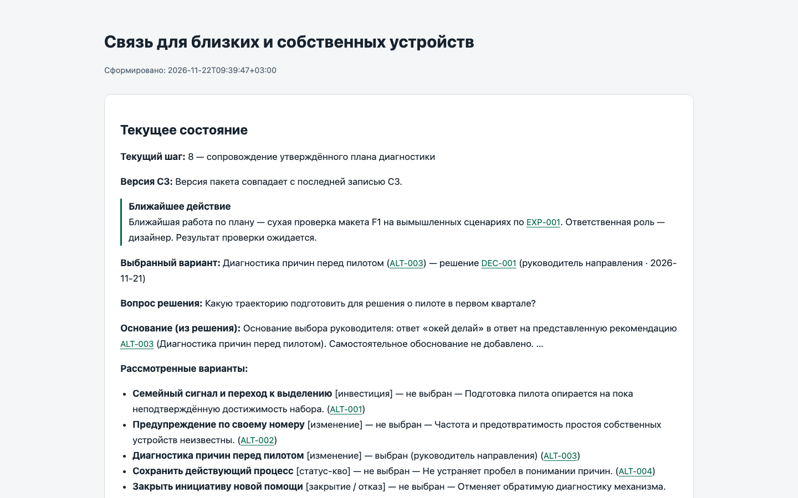
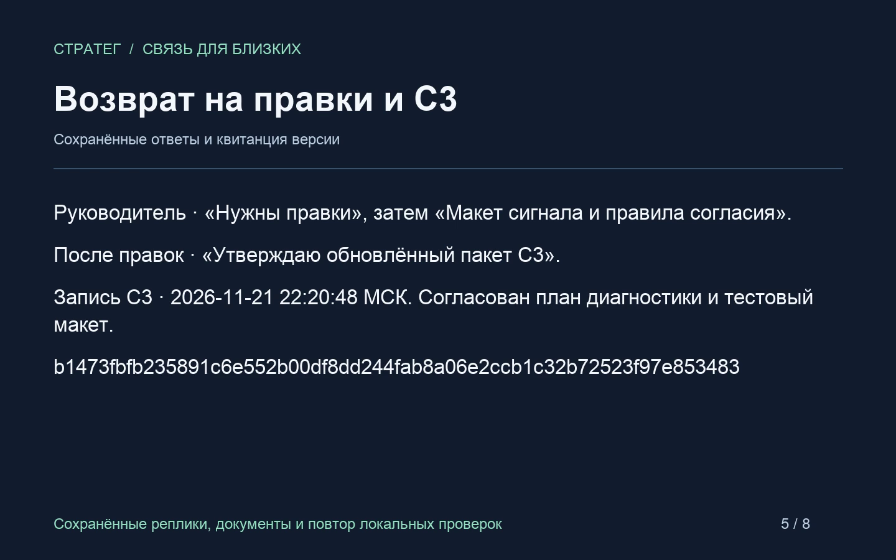
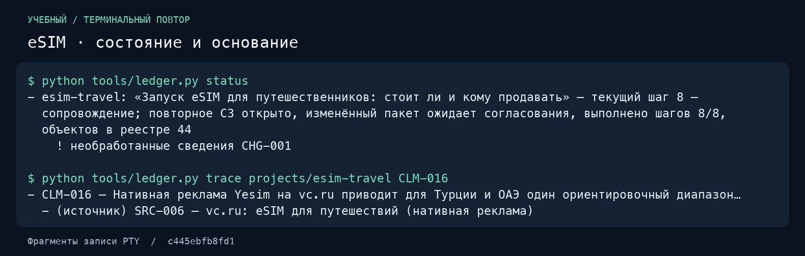
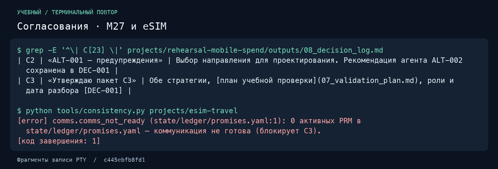

# Стратег Фабрики продуктов

Стратег помогает руководителю выбрать, во что вкладываться и что обещать клиенту. Папку открывают в агентной среде и задают вопрос обычными словами. На выходе руководитель получает варианты с возражениями, продуктовую и коммуникационную стратегии, план проверки и журнал решения. В готовом HTML-отчёте можно открыть основания вывода по его идентификатору. [Отчёт «Рядом»](../projects/ryadom/outputs/report.html)

Официальный демонстрационный кейс «Связь для близких и собственных устройств» содержит исходный бриф, пять вариантов, обе стратегии и протокол проверки. Состояние согласований и следующая реплика руководителя видны в отчёте. [Стратегия в пяти частях](../projects/family-connect/outputs/00_brief_response.md) · [Отчёт по кейсу](../projects/family-connect/outputs/report.html) · [Карта доказательств](JURY_EVIDENCE.md)

Руководитель вернул первый пакет на правки, затем утвердил исправленный макет и план диагностики. Новая сессия восстановила согласованный выбор и открыла сопровождение. [Условия конкурса](TZ_OFFICIAL.md) · [Демонстрация «Связь для близких», 1 мин 44 с](../evals/score9/demonstration/family-connect.mp4) · [Журнал решений](../projects/family-connect/outputs/08_decision_log.md)

## Как принимается и пересматривается решение

1. Агент выделяет из запроса спорный выбор, аудиторию, цель и ограничения. Руководитель подтверждает рамку на **C1**. Затем агент составляет план исследования, собирает документы, таблицы и открытые веб-источники, выписывает проверяемые утверждения и указывает пробелы.
2. Агент сравнивает как минимум три варианта, включая сохранение текущего подхода, и рассматривает закрытие направления либо объясняет его неприменимость. Для каждого указывает сильное возражение. На **C2** руководитель выбирает вариант и может разойтись с рекомендацией.
3. Для выбранного направления агент связывает пользовательскую пользу и затраты, каждое коммуникационное обещание — с возможностью продукта. У каждого эксперимента есть база сравнения, показатель, срок и условия остановки. На **C3** руководитель утверждает пакет.
4. Новые сведения получают отдельную запись. Команда `impact` находит затронутые гипотезы, обещания и эксперименты. Агент обновляет документы, сохраняет прежние основания и при необходимости возвращает выбор человеку. [Основной процесс](../workflows/strategy.md) · [Процесс пересмотра](../workflows/update-decision.md)

В кейсе «Рядом» команда исследовала уход семей из сервиса геолокации. В учебной сводке 58% ушедших за первые две недели ушли на 6–8-й день, около окончания пробного периода. Причина ухода осталась открытой. Руководитель выбрал проверить, какую повторяющуюся пользу семья готова оплачивать. Поэтому коммуникационная стратегия предлагает выяснить, понимают ли семьи условия оплаты, и оставляет сообщения о геопозиции на стадии черновика. [Продуктовая стратегия](../projects/ryadom/outputs/05_product_strategy.md) · [Коммуникационная стратегия](../projects/ryadom/outputs/06_comms_strategy.md) · [План проверки](../projects/ryadom/outputs/07_validation_plan.md)

## Архитектура, модели и инструменты

Постоянные инструкции задают порядок решений. В `skills/` хранятся процедуры, в `knowledge/` — шаблоны, рубрики и правила выбора моделей. Каждый кейс хранит оригиналы или выдержки в `sources/`, типизированные записи с цитатами и локаторами в `state/ledger/`, выводы в `outputs/`. Факт, интерпретация, допущение, гипотеза и прогноз различаются явно. Новый чат читает шаг и открытые вопросы из `progress.md`, а выполненные действия — из `run_log.md`. [Правила агента](../AGENTS.md) · [Схема связей](DATA_MODEL.md)

В поставке два независимых контура: **основной рабочий процесс** (достаточен для всей продуктовой работы и проверки жюри) и **опциональная маршрутизация** (подключается отдельно и не требуется для старта).

### Основной рабочий контур (обязательный минимум)

| Компонент | Что делает и что требуется для запуска |
|---|---|
| Python 3.9+, PyYAML, jsonschema, pytest | Локальные офлайн-команды без вызовов моделей: `ledger.py` (реестр, `status`, `validate`, `trace`, `impact`), `verify.py` (проверка чисел и ссылок), `consistency.py` (согласованность пакета), `c3_approval.py` (`prepare`/`record`/`check` квитанции C3), `next.py` (очередь действий и `--resume`), `report.py` (сборка и `--check` автономного HTML), `cost.py` (пересчёт токенов по журналам). Для чтения готового HTML-отчёта достаточно браузера. |
| Таблицы и расчёты | `datacheck.py` проверяет пропуски, дубли, периоды и единицы в CSV (для XLSX нужен `openpyxl`). `econ.py` и `power.py` воспроизводят сценарную экономику и размер выборки. Интерпретация чисел требует проверки источника. |
| Одна модель в агентной среде | Нужна только при работе над новой задачей или продолжении диалога; поиск и доступ к модели предоставляет сама IDE/среда. Полные учебные прогоны зафиксированы в Codex и ZCode. В официальном кейсе «Связь для близких» Codex GPT-6.2 Sol (`high`) подготовил стратегии и план, `pdftotext` использовался для сверки страниц исходного PDF. [Журнал кейса](../projects/family-connect/state/run_log.md) |
| Модели других учебных прогонов | В Codex модель GPT-6.1 Sol сравнивала варианты и готовила стратегии «Рядом», GPT-6 Luna проверяла утверждения. В ZCode весь кейс eSIM прошёл на GLM-5.3-Flash. Репетиция предупреждений прошла на основной модели Codex, точная версия в её отчёте не указана. Orca использовалась для рабочих пространств. В Antigravity отдельно проверили перенос открытого C1 и разбор кадров интерфейса. |

### Опциональный контур маршрутизации и интеграций (не требуется для базовой работы)

| Компонент | Назначение и проверенная граница |
|---|---|
| Локальный маршрутизатор и уровни T0–T4 | T0 выполняет код; T1 — извлечение и сверка (Luna / Haiku); T2 — планы, коммуникации и пересмотр (Terra / Sonnet); T3 — варианты и стратегия (Sol / Opus); T4 — согласованная эскалация (Astra / Fable). `models.py` выбирает доступную версию; `decide.py`, `route_request.py`, `delegate.py`, `document_flow.py` разделяют классификацию и чтение документов по карточкам с цитатами и локаторами. |
| Классификаторы и внешние подключения | Локальный LiquidAI D1-2B MLX 8-bit проверялся только на Apple Silicon; на 4 учебных запросах он выбрал ожидаемый уровень 3 раза, порог уверенности прошли 2 запроса, фактических запусков LLM через этот профиль было 0. Интерфейс Jev/System One проверен в эмуляции, Perplexity Decider через OpenRouter — в отдельном опыте; возможны OpenCode и совместимый endpoint. |
| Интеграции сред и MCP | MCP-сервер (`tools/mcp_server.py`) открывает операции реестра через stdio. Настройки есть для Codex (`.codex/hooks.json`), Claude Code и Cursor, но наличие конфигурации не означает подтверждённого исполнения средой: native runtime gate Claude и отдельное приложение Codex desktop не подтверждены сквозным прогоном. На Windows/WSL и без Apple Silicon базовый рабочий процесс работает напрямую моделью среды; диагностика окружения — `.venv/bin/python tools/doctor.py doctor --host <среда>`. |

Официальный сквозной прогон «Связи для близких» и все 36 офлайн-проверок комплекта опираются только на основной рабочий контур и не зависят от D1, MCP или внешних API. [Зависимости](../requirements.txt) · [Карта маршрутов](../knowledge/routing.yaml) · [Дополнительные интеграции](ROUTING_ADVANCED.md) · [Границы host-маршрутизации](NATIVE_HOST_ROUTING.md) · [Диагностика установки](ONBOARDING.md)

## Какие инструкции задавали работу

**При создании репозитория.** Сохранились задания разработчикам с критериями приёмки. В задании по отчёту прямо указано «один HTML-файл. Никаких внешних ресурсов». В задании по табличным данным требовалось проверить таблицу до извлечения утверждений и сохранить обнаруженные ограничения. Эти тексты позволяют сверить замысел с реализацией. Полная последовательность исходных реплик авторов в материалах не установлена. [Сборка HTML](../tools/report.py) · [Проверка таблиц](../tools/datacheck.py)

**При работе с продуктом.** Пример из брифа репетиции — «Стоит ли пилотировать предупреждения о перерасходе мобильного интернета для малого бизнеса и как объяснить их пользу?» Инструкция по извлечению требует указать источник, цитату или локатор и ограничения. Инструкция верификатора требует проверить, поддерживает ли источник конкретный вывод. На возражение руководителя агент повторно проверяет основание. [Бриф репетиции](../projects/rehearsal-mobile-spend/outputs/01_brief.md) · [Приём материалов](../skills/source-intake/SKILL.md) · [Проверка утверждений](../skills/claim-verifier/SKILL.md) · [Самоаудит](../skills/self-audit/SKILL.md)

## Что удалось проверить

**Офлайн-воспроизведение поставки без моделей.** Из чистого распакованного архива без истории Git единый сценарий `.venv/bin/python evals/score9/jury/run.py` выполняет **36 офлайн-команд** (`model_calls: 0`) на изолированных временных копиях и проверяет официальный кейс `family-connect`, новый C1 (`jury-library`), сохранённый M27, повторное C3 в `esim-travel`, отрицательные контроли (`CLM-999`, `CHG-999`) и 7 контролей записи квитанции C3 (5 отклонений без изменения байтов, 1 запись, 1 идемпотентный повтор). После прогона SHA-256 всех исходных файлов кейсов остаются неизменными. Полный набор автотестов `.venv/bin/python -m pytest -q tests` в чистой распаковке прошёл с результатом **1 552 passed, 1 skipped**. Подробный состав 36 команд и пошаговые команды проверки — в [карте доказательств](JURY_EVIDENCE.md#быстрый-путь-проверки-команды-и-36-офлайн-проверок).

**«Связь для близких», первый проход до предъявления C3.** Между начальной проверкой брифа для кандидата и записью о подготовке пакета прошло 20 минут 39 секунд. Руководитель дважды ответил на согласованиях. Активное время человека и отдельная цена поиска не измерялись. Модельная проверка готовности не запустилась, поэтому список вопросов прошли вручную. [Журнал официального кейса](../projects/family-connect/state/run_log.md)

За это окно журнал рабочей сессии Codex GPT-6.2 Sol на машине автора (каталог сессии `night-orchestrator`, окно 21:07:26–21:28:06 MSK от 21 ноября 2026 года) показывает 276 201 обычный входной токен, 19 647 488 кешированных входных токенов и 48 883 выходных токена. `cost.py` оценивает их в **$3,006 по ставкам Standard из репозитория**. Это оценка общего окна рабочей сессии, которая включает команды по сборке кандидата. Ставки для отдельных запросов с длинным контекстом не пересчитывались; сумма не отражает списание по подписке или полную стоимость работы. На другой машине исходный журнал сессии отсутствует, поэтому сторонний проверяющий может перепроверить арифметику по указанным счётчикам и [ставкам модели](../knowledge/prices.yaml) либо замерить собственный прогон командой `.venv/bin/python tools/cost.py --cwd <папка-сессии> --since <время-начала>`. [Калькулятор](../tools/cost.py)

**Продолжение после C3.** В новом чате Codex GPT-6.2 Sol за 80,6 секунды восстановил решение, сверил SHA-256 и оформил первую задачу сопровождения. По локальным счётчикам только этого потока API-эквивалент составляет $0,2680 по ставкам Standard. Руководитель дал пять содержательных ответов по официальному кейсу. Активное время человека, оплата подписок и полная стоимость неизвестны. [Отчёт о прогоне](../projects/family-connect/outputs/09_run_report.md)

| Учебный прогон | Время, участники и ошибки | Расход моделей |
|---|---|---|
| «Рядом» | 95,8 минуты первого прохода, включая ожидание. Координатор отвечал за руководителя на C1–C3, затем подтвердил пересмотр. Один веб-поиск агент начал до записи плана и зафиксировал нарушение в журнале. | $3,0331 API-эквивалента за подготовку и пересмотр решения. Из $3,2351 за всё окно исключено отдельное задание о конкуренте. [Пересчёт по семи потокам](../evals/score9/cost-case/NOTE.md) |
| eSIM для путешественников | Между первой и последней записью шагов прошло 31,5 минуты. Координатор трижды ответил на согласованиях и попросил перепроверить цену. По официальной странице значение исправили с 399 до 599 ₽/день. После последующего аудита повторное C3 открыто, прежние обещания отозваны. | $0,4507 за окно 17:30–19:00. Позднейший аудит вне окна. [Отчёт](../projects/esim-travel/outputs/09_run_report.md) · [Текущее состояние](../projects/esim-travel/state/progress.md) |
| Предупреждения о расходе связи | 17 минут 47 секунд до C3, три ответа человека. Руководитель выбрал разработку макета предупреждения, хотя агент рекомендовал отчёт. Ошибка схемы гипотезы исправлена, при недоступности модельной проверки пройдена ручная сверка. Полевой эксперимент остаётся в плане. | В выбранном окне журналов не нашлось токенов. Денежный итог неизвестен. [Отчёт](../projects/rehearsal-mobile-spend/outputs/09_run_report.md) |

Суммы — API-эквивалент по журналам и ценам моделей на дату прогона. Оплата подписки, стоимость рабочего времени людей и отдельная цена поиска в эти суммы не входят. В ноябрьской проверке продолжения eSIM все шесть ответов прошли четыре заранее заданных условия. В двух из трёх пар короткая инструкция стоила дешевле; медианная разница за один ответ составила −0,0229 USD по тарифу API и −8,6 секунды. Сравнивались две версии одного агента на одном учебном запросе. [Условия и три пары измерений](evidence/resume-cost.json)

В отдельной учебной пробе Sol 6.1 high ответил на одинаковый запрос с инструментами Стратега и в обычном чате. Независимая оценка дала 4/4 и 2/4 по четырём заранее выбранным признакам. Разницу объяснили сохранённое решение руководителя и ссылка на его основание. Время и расход этой пары не сравнивались. [Протокол и ответы](../evals/score9/paired-handoff/README.md)

На трёх других запросах независимая проверка дала обычному чату 10/10, Стратегу 9/10. Два неоднозначных признака исключены перед оценкой обеих сторон. Стратег оставил альтернативную причину в брифе слишком общей. По замечанию уточнили процедуру постановки задачи. Результат относится к одной пробе на режим и не сравнивает полную стоимость. [Запросы, ответы и разбор](../evals/score9/paired-handoff/three-requests/README.md)

В парном слепом сравнении пересмотра после утверждённого C3 (`post-c3`) обычный чат и «Стратег» набрали по 12/12 на двух синтетических сценариях; механическое разграничение режимов C2+C3, повторного C3 и неизменного C3 воспроизводится офлайн отдельным CLI-скриптом на изолированных копиях текущего кандидата. [Условия, хеши и воспроизведение `post-c3`](../evals/score9/factory-experiments/post-c3/README.md)

В живой проверке на двух копиях обе сессии Neon внесли одинаковую учебную редактуру, сохранили выбор `ALT-003` и открыли повторное C3. От старта до ответа прошло 145,0 с с инструментами Стратега и 215,4 с с обычными файловыми операциями. Это время одной пары сеансов на общем хосте. Свежая сессия восстановила состояние из папки без записи. [Протокол, время и хэши](../evals/score9/factory-experiments/post-c3/LIVE_REVISION.md) · [Запросы и ответы](../evals/score9/factory-experiments/post-c3/LIVE_REVISION_RESPONSES.md)

Из дополнительных возможностей проверены сохранение состояния, пересмотр зависимостей, чтение открытого C1 в другой среде и разбор видимых областей PNG. Синтетические интервью помогают поставить гипотезу. Спрос, поведение пользователей и эффект пилота требуют полевой проверки. Для аудио и видео сквозной анализ материала в этих кейсах не показан. Обязательства проверяются при открытии проекта или запросе руководителя. Внешнее уведомление потребовало бы отдельной интеграции.

## Официальный кейс в отчёте и демонстрации

На первом экране отчёта видны выбранный вариант, действующая версия C3 и ближайшее действие. Под ним кадр демонстрации на 1:00 с двумя сохранёнными репликами руководителя и хэшем утверждённого пакета. [Открыть отчёт](../projects/family-connect/outputs/report.html) · [Квитанция C3](../projects/family-connect/state/c3_approvals.json)

## Кадры учебного терминального повтора

Команды читали сохранённые кейсы. Первый кадр ведёт от решения к источникам, второй показывает последствия новых данных, третий сопоставляет утверждённое решение по предупреждениям и открытое повторное согласование eSIM.

