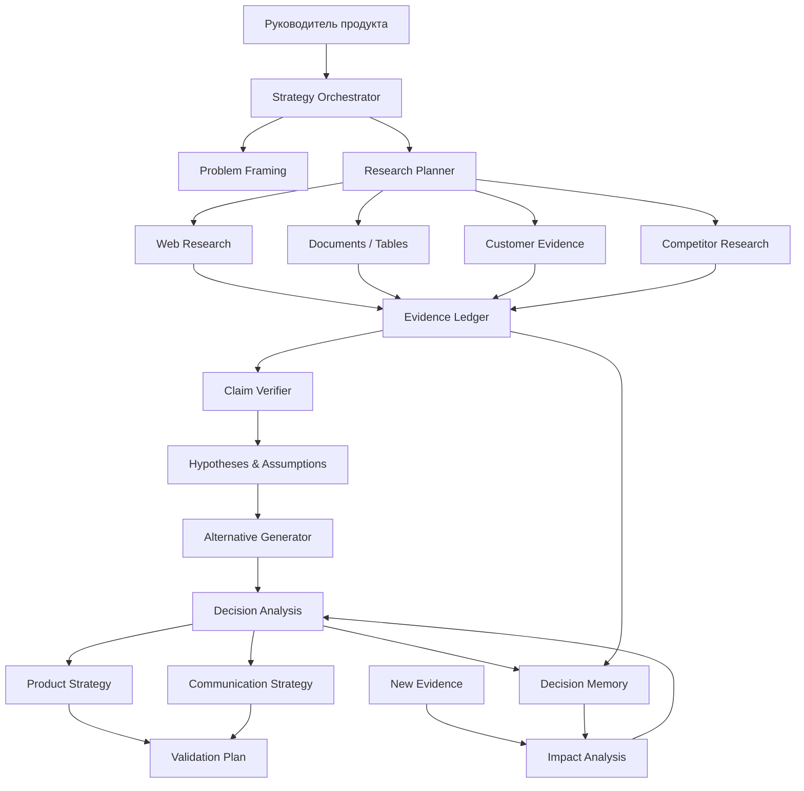
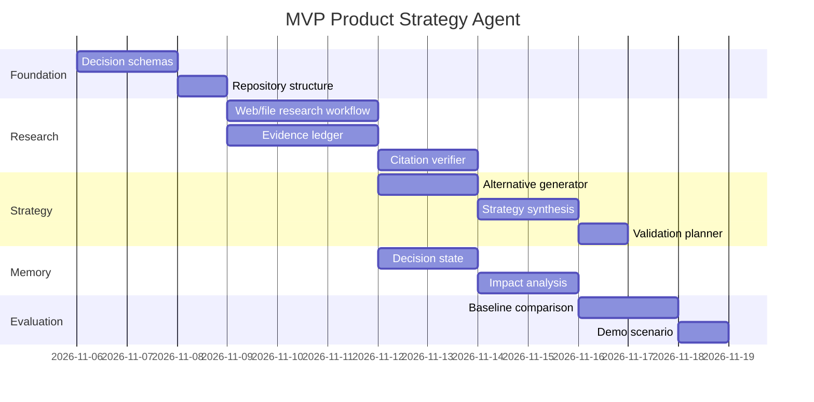

# Исследование: какой AI-агент стоит создать для «Фабрики продуктов» МегаФона

## Исполнительное резюме и разбор задачи

Присланный файл задаёт не просто идею «AI-помощника для продакт-менеджера», а гораздо более сильную конструкцию: **систему поддержки продуктовых решений**, которая должна провести руководителя от неоднозначного бизнес-запроса через исследование, проверку гипотез, сравнение альтернатив и разработку продуктовой и коммуникационной стратегии — а затем сохранить основания решения и пересмотреть его, если появятся новые данные. Критически важно, что результат должен быть реализован **как репозиторий инструкций, знаний и инструментов для LLM-агента, запускаемый в средах наподобие Cursor/Codex/Claude Code, а не как отдельное приложение**. fileciteturn0file0

Наиболее сильная концепция для хакатона поэтому — не «самый автономный агент» и не «команда из десяти агентов», а **Decision Intelligence Agent / Product Strategy OS**: агент, который строит *проверяемую модель решения*. Его дифференциация от обычного ChatGPT — не столько в способности написать красивый отчёт, сколько в пяти механизмах: **evidence ledger** с источниками и уровнем уверенности; явное разделение фактов, гипотез, прогнозов и рекомендаций; обязательное сравнение альтернатив, включая статус-кво и закрытие направления; сохранение decision state и причин выбора; автоматический impact analysis при появлении новых данных. Такой акцент напрямую следует из требований файла. fileciteturn0file0

Рынок в 2024–2026 годах движется именно в эту сторону. Deep-research-системы уже умеют выполнять многошаговый поиск и синтез большого числа источников; enterprise AI смещается от генерации текста к агентам, работающим с корпоративным контекстом; продукты вроде Glean, Dovetail, Enterpret и Sprig превращают разрозненные знания и обратную связь в структурированный контекст для принятия решений. При этом исследования RAG и long-form factuality показывают, что сам факт наличия retrieval не гарантирует достоверность: необходимо измерять полноту контекста, support rate, качество цитирования и фактическую корректность. citeturn489654search4turn489654search5turn489654search19turn272009search2

Из файла следуют четыре главные категории боли. Первая — **исследовательский хаос:** информация находится в документах, вебе, таблицах, исследованиях и пользовательской обратной связи, а продуктовый руководитель вручную соединяет её в картину. Вторая — **непроверяемость выводов:** обычный LLM легко смешивает факты, предположения и убедительно звучащие домыслы. Третья — **decision drift:** после принятия решения теряется, почему именно оно было принято и какие предположения лежали в его основе. Четвёртая — **слабая связка discovery → стратегия → коммуникация → проверка результата:** каждый этап часто существует как отдельный документ. Все четыре проблемы отражены в структуре задания. fileciteturn0file0

### Ключевые требования из файла

| Требование | Зачем это нужно | Что должен выдавать агент | Как доказать |
|---|---|---|---|
| Уточнять неоднозначный запрос | Не оптимизировать неправильную постановку | Problem frame, цели, неизвестные, критерии решения | Сравнить исходный запрос и reformulated brief |
| Исследовать рынок, пользователей и конкурентов | Снизить субъективность стратегии | Evidence-backed research pack | Источники на уровне утверждений |
| Разделять факты и гипотезы | Снижать ложную уверенность | Fact / hypothesis / forecast / recommendation ledger | Выборочная ручная проверка |
| Давать ≥3 альтернатив | Избежать преждевременной фиксации на одной идее | Альтернативы, включая status quo | Проверить наличие реально разных вариантов |
| Рассматривать закрытие направления | Не поддерживать sunk-cost bias | Kill / pause option | Явная альтернатива |
| Связывать продукт и коммуникацию | Не обещать того, чего продукт не делает | Product strategy + communication strategy | Traceability между promise и feature |
| Делать выводы проверяемыми | Доверие и воспроизводимость | Цитаты, provenance, confidence | Citation verification |
| Давать план проверки | Перевести стратегию в эксперимент | Метрики, тесты, stop/go criteria | Наличие измеримых критериев |
| Сохранять контекст | Поддерживать долгоживущую работу | Decision state | Restart test |
| Пересматривать выводы | Стратегия не должна быть статичным PDF | Impact graph + revised conclusions | Change-data test |
| Контролировать стоимость | Agentic workflows могут быть дорогими | Cost log / routing | Стоимость на кейс |
| Работать из агентного репозитория | Это ограничение конкурса | Skills, prompts, tools, evals, state | Запуск в целевой среде |

Источник требований — предоставленный файл. fileciteturn0file0

Отдельного файла с официальным полным ТЗ МегаФона в доступных материалах нет: загруженный документ сам ссылается на `МегаФон_ИИ-проект_полный_текст.md` как на основной источник. Поэтому **соответствие конкретным официальным формулировкам сверх изложенных в вашем файле пока нельзя считать установленным фактом**. В дальнейших оценках я считаю приведённые в файле ограничения рабочей спецификацией, а неизвестные детали официального ТЗ — неопределённостью. fileciteturn0file0

## Карта болей и рыночных трендов

Самая важная тенденция 2025–2026 годов — переход от «чат-бота, который отвечает» к **agentic workflows, которые планируют, ищут, используют инструменты, поддерживают состояние и выполняют составные рабочие процессы**. OpenAI описывает deep-research-модели как agentic systems для многошагового исследования; Anthropic показывает преимущество multi-agent research прежде всего в широких и параллелизуемых исследовательских задачах; Microsoft Agent Framework выделяет session state, context providers, middleware и MCP-инструменты как базовые строительные блоки агентных систем. citeturn489654search36turn489654search25turn489654search34

Второй тренд — **enterprise context становится важнее самой модели**. Glean вырос из enterprise search в инфраструктуру для ассистентов и агентов, индексируя корпоративные приложения с учётом прав доступа; компания сообщила о $200 млн ARR к декабрю 2025 года и более чем 27 млрд проиндексированных документов. Это vendor-reported метрики, но они хорошо показывают коммерческий спрос на слой контекста и governance вокруг LLM. citeturn272009search2

Третий тренд — **feedback intelligence и continuous discovery**. Dovetail в 2025 году превратил research repository в AI-native customer intelligence platform, которая агрегирует интервью, обращения поддержки, опросы и sales calls, анализирует их и передаёт выводы в продуктовые workflow. Enterpret строит Customer Knowledge/Context Graph поверх обратной связи, а Sprig в 2026 году позиционирует Research Agents как способ автоматизировать часть пользовательских исследований. citeturn272009search3turn214018search0turn214018search28

Четвёртый тренд — **от генерации ответа к доказательности ответа**. Google DeepMind предложил SAFE для автоматизированной проверки long-form factuality; FRAMES разделяет retrieval, factuality и reasoning; TREC RAG 2025 использует Sentence-Support Rate и coverage metrics. Это напрямую применимо к хакатону: оценивать агента следует не по «насколько убедительно выглядит стратегия», а по доле утверждений, которые имеют достаточное доказательство, качеству покрытия и корректности атрибуции. citeturn489654search2turn489654search5turn489654search9

Пятый тренд — **MCP и стандартизация доступа к инструментам**. MCP даёт единый интерфейс для подключения источников данных и инструментов; он поддерживается в экосистемах Anthropic, OpenAI и других агентных фреймворках. Для вашего решения это особенно ценно, потому что агентный репозиторий сможет подключать web search, файлы, аналитические источники или внутренние сервисы без жёсткой привязки ко всему приложению. citeturn489654search28turn489654search11

Шестой тренд — **human-in-the-loop вместо полной автономности там, где решение дорого или стратегически значимо**. Даже публичный кейс МегаФона о применении генеративного AI подчёркивает связку human+AI: рутину отдавать машине, а критическое мышление и ответственность оставлять человеку. Это хорошо совпадает с требованиями задания о поддержке решения, а не о полном замещении руководителя продукта. citeturn415500search1

### Боли: приоритет, рынок и возможность

| Приоритет | Боль | Частота | Влияние | Тренд 2024–2026 | Что остаётся нерешённым |
|---|---|---:|---:|---|---|
| 1 | Разрозненные доказательства | Очень высокая | Очень высокое | Enterprise RAG, knowledge graphs, customer intelligence | Связать внешние и внутренние данные именно с продуктовым решением |
| 2 | Непроверяемые выводы LLM | Очень высокая | Очень высокое | Citation verification, RAG evals, factuality | Большинство PM-инструментов не ведут claim-level evidence ledger |
| 3 | Потеря контекста решения | Высокая | Очень высокое | Agent memory, session state | Хранится чат, но не логика decision-making |
| 4 | Confirmation bias | Высокая | Высокое | Multi-agent critique, scenario generation | Системы часто помогают развить выбранную идею, но не заставляют рассмотреть «не делать» |
| 5 | Медленный market research | Высокая | Высокое | Deep Research | Результат часто остаётся одноразовым отчётом |
| 6 | Feedback overload | Высокая | Высокое | VoC AI, automated taxonomy | Сложно связать feedback → hypothesis → strategy |
| 7 | Слабая связь продукта и коммуникации | Средняя | Высокое | AI-assisted positioning | Генераторы маркетингового текста легко «переобещают» |
| 8 | Стратегия устаревает после новых данных | Средняя | Очень высокое | Continuous agents, stateful workflows | Почти нет распространённого product decision impact analysis |
| 9 | Неясная стоимость agentic AI | Растущая | Среднее | Model routing, eval-driven routing | Часто используют дорогую модель на каждый шаг |
| 10 | Недоверие к AI-стратегу | Высокая | Очень высокое | Provenance, HITL, evals | Нужен traceability от рекомендации до источника |

Для telecom-контекста это особенно релевантно. ITU в 2025 году отдельно подчёркивает необходимость use-case-specific evaluation GenAI в телеком-среде, включая качество, безопасность и другие эксплуатационные требования. Deutsche Telekom развивает AI competence center и продуктово-ориентированное применение GenAI, Vodafone сообщал об 85% сокращении времени анализа кампаний в одном из agentic CVM use cases, а SK Telecom масштабировал AI-assistant до более чем 10 млн пользователей, сочетая RAG, context management и итеративную validation с use-case planners. Эти кейсы не доказывают эффект именно для product strategy, но показывают, что telco уже движется от экспериментов к управляемым AI workflows. citeturn489654search21turn489654search1turn489654search8turn489654search6

Публичная информация о самом МегаФоне тоже указывает на зрелый data/AI-контекст: группа работает с аналитикой и обработкой больших данных; в 2025 году компания начала миграцию аналитической платформы на отечественный стек Arenadata, а публичные продукты включают AI-сегментацию для рекламных кампаний и потребительские AI-сервисы. Это подтверждает наличие широкого data/AI-контекста, но **не позволяет делать вывод, что внутренние продуктовые команды МегаФона работают конкретно тем способом, который предполагается в нашем концепте**. citeturn415500search10turn415500search6turn415500search9

## Конкурентный ландшафт, стартапы и лучшие практики

Рынок уже хорошо решает отдельные куски цепочки, но плохо решает всю цепочку **«evidence → alternatives → decision → strategy → validation → revision»**. Это и есть наиболее привлекательная незакрытая ниша.

| Компания / продукт | Решаемая проблема | Модель / стадия | Публичные метрики | Что взять в наш проект | Чего не хватает |
|---|---|---|---|---|---|
| **Glean** | Поиск и AI по корпоративным знаниям | Enterprise SaaS, unicorn | Series F, valuation $7.2B; vendor-reported ARR $200M в 2025 | Permissions-aware retrieval, enterprise context | Не PM-specific decision framework |
| **Perplexity** | Быстрый web research с источниками | Subscription + enterprise + usage, unicorn | Последняя публично сообщавшаяся оценка около $20B в 2025; финансовые метрики частично внешние оценки | Citation-first research UX | Не хранит полноценно decision state |
| **Dovetail** | Синтез user research и feedback | B2B SaaS | Частная компания, точная текущая valuation не публикуется | Evidence at source level, clips, research memory | Фокус на customer evidence, не на всей стратегии |
| **Productboard** | PM planning, feedback → features | B2B SaaS | AI как paid add-on | Feedback → feature traceability | Более слабая работа с внешним market research |
| **Enterpret** | Customer feedback intelligence | B2B SaaS, Series A | $20.8M Series A | Customer Context Graph, automated taxonomy | Не полный strategic decision engine |
| **Unwrap.ai** | Массовый feedback analysis | B2B SaaS, Series A | $12M Series A, 2025 | Automated VoC, anomaly detection | Фокус на feedback, а не strategy lifecycle |
| **Sprig** | Continuous user research | B2B SaaS, venture-backed | объявляла $30M нового финансирования; AI Research Agents в 2026 | Research agents, in-product research | Требуется реальная пользовательская выборка |
| **OpenAI Deep Research** | Многошаговое внешнее исследование | Platform/API | benchmark и system-card evidence | Planner/search/synthesis | Сам по себе не PM workflow |
| **Anthropic Research** | Параллельный сложный поиск | Platform | Опубликована архитектура multi-agent research | Subagents для независимых research tracks | Multi-agent cost/complexity |
| **Microsoft Agent Framework** | Enterprise agent orchestration | Framework | Open tooling/platform | State, middleware, MCP, orchestration | Не готовая product methodology |

Glean сообщил о $150 млн Series F при оценке $7.2 млрд в июне 2025 года; позднее компания заявила о $200 млн ARR. citeturn272009search0turn272009search2 Perplexity оценивался примерно в $20 млрд после финансирования 2025 года по сообщениям профильной прессы; текущие revenue estimates различаются и не следует считать их аудированными показателями. citeturn272009search6turn272009search5 Enterpret привлёк $20.8 млн Series A, а Unwrap указывает $12 млн Series A в 2025 году. citeturn214018search0turn214018search14

Особенно интересен не размер компаний, а **паттерн их эволюции**. Glean начал с поиска, затем добавил assistants и agents. Dovetail начал с research repository, затем перешёл к continuous customer intelligence и AI agents. Enterpret расширяет customer feedback до context graph и MCP. Это говорит о том, что устойчивая ценность возникает не в генерации текста, а в накоплении структурированного контекста, который затем можно использовать агентами. citeturn272009search2turn272009search3turn214018search24

С точки зрения лучших практик наиболее зрелыми выглядят следующие подходы:

- **Evidence-first:** каждое важное утверждение должно быть связано с доказательством; Dovetail делает акцент на переходе от ответа обратно к исходному фрагменту пользовательского исследования. citeturn272009search8
- **Retrieval sufficiency before generation:** Google Research показывает, что наличие retrieval ещё не означает наличие достаточного контекста; агент должен уметь зафиксировать «данных недостаточно». citeturn489654search19
- **Iterative retrieval + verification:** OpenScholar улучшает long-form synthesis итеративным retrieval и self-feedback, а не одним поисковым запросом. citeturn489654search29
- **Tool specialization:** Anthropic рекомендует проектировать инструменты с понятными границами вместо того, чтобы давать агенту десятки плохо различимых функций. citeturn489654search23
- **Evaluation as part of product:** современные agent frameworks и исследовательские benchmarks рассматривают evals как обязательный слой, а не как финальное тестирование. citeturn489654search30turn489654search32

Отсюда появляется заметный white space: **ни один из перечисленных классов продуктов не является полноценным «Git для продуктового решения», где существуют source evidence, hypotheses, alternatives, choice, assumptions, strategy и зависимости между ними, а новые данные автоматически показывают, какие выводы стали сомнительными**. Это уже аналитический вывод из сравнения, а не публично заявленный факт. citeturn272009search3turn272009search4turn214018search21turn272009search2

## Возможности продукта и пять приоритетных функций

Я оценивал идеи по модели из вашего файла: соответствие задаче — 25%, практическая бизнес-ценность — 25%, доказательность — 20%, реализуемость в agent repository — 15%, экономичность/удобство — 15%. fileciteturn0file0

Шкалы являются **аналитической оценкой, а не измеренными рыночными показателями**. Сложность дана от 1 — просто до 5 — сложно; итоговый балл — взвешенная оценка из 5.

| Идея | Влияние | Сложность | Уникальность | Соответствие заданию | Итог /5 |
|---|---:|---:|---:|---:|---:|
| Evidence Ledger + claim verification | 5 | 3 | 5 | 5 | **4.85** |
| Decision Memory + impact graph | 5 | 4 | 5 | 5 | **4.75** |
| Alternative Strategy Generator | 5 | 2 | 4 | 5 | **4.70** |
| Research Orchestrator | 5 | 3 | 3 | 5 | **4.55** |
| Strategy Validation Planner | 5 | 2 | 4 | 5 | **4.55** |
| Contradiction Detector | 4 | 3 | 5 | 5 | 4.45 |
| Product ↔ Communication traceability | 4 | 2 | 5 | 5 | 4.40 |
| Customer Signal Synthesizer | 5 | 3 | 3 | 4 | 4.25 |
| Competitor Change Monitor | 4 | 3 | 3 | 4 | 4.10 |
| Cost-aware Model Router | 3 | 3 | 4 | 4 | 3.95 |
| Scenario / sensitivity analysis | 4 | 4 | 4 | 4 | 3.90 |
| Strategy red-team agent | 4 | 3 | 3 | 4 | 3.85 |
| Automated JTBD clustering | 4 | 3 | 3 | 4 | 3.80 |
| Synthetic user panel | 2 | 3 | 2 | 2 | **2.45** |
| Autonomous roadmap executor | 2 | 5 | 3 | 2 | **2.20** |

### Приоритетная функция: Evidence Ledger

Это должно быть ядро продукта. Любой существенный вывод записывается как объект:

`claim → type → evidence → source → date → confidence → contradicting evidence → affected decisions`.

Например:

```text
CLAIM-032
Тип: факт
Утверждение: пользователи сегмента X жалуются на Y
Источники: SRC-04, SRC-11
Уверенность: medium
Ограничение: выборка состоит только из обращений в поддержку
Использовано в: HYP-07, DECISION-03
```

Пользователь получает не просто «исследование», а **проверяемую систему аргументации**. Это прямо закрывает главный риск LLM — убедительную, но плохо подкреплённую генерацию. Исследования factuality и RAG-evaluation дают достаточную методологическую основу для такого дизайна. citeturn489654search2turn489654search5turn489654search9

### Приоритетная функция: Decision Memory и impact analysis

После выбора стратегии агент сохраняет не только финальный ответ, но:

`decision → alternatives → reasons → evidence → assumptions → metrics → invalidation triggers`.

Если через неделю появляется новая информация, агент не переписывает всё исследование. Он выполняет:

`new evidence → affected claims → affected assumptions → affected alternatives → affected decision`.

Это наиболее сильный кандидат на **wow-effect для жюри**, потому что обычный чат хорошо делает первый отчёт, но плохо демонстрирует жизненный цикл решения. Требование пересматривать решения при новых данных прямо зафиксировано в файле. fileciteturn0file0

### Приоритетная функция: обязательное пространство альтернатив

Перед рекомендацией агент должен всегда сформировать несколько содержательно разных путей:

A. инвестировать и масштабировать;  
B. изменить сегмент / ценностное предложение;  
C. минимально поддерживать / оставить status quo;  
D. при необходимости — закрыть направление.

Это не «генерация пяти идей». Агент должен сравнить альтернативы по одному набору критериев и показать, какие факты способны изменить ranking. Такой mechanism особенно полезен против confirmation bias и premature convergence.

### Приоритетная функция: Research Orchestrator

Агент строит research plan на основе неизвестных и потенциальной стоимости ошибки. Он не должен одинаково глубоко исследовать всё. При неопределённости рынка — больше внешнего поиска. При споре о клиентской боли — больше VoC. При финансовом trade-off — запрос данных или явная фиксация отсутствия данных.

Deep Research показывает жизнеспособность многоэтапного agentic research; Anthropic показывает пользу параллельного разбиения именно для широких research-задач. citeturn489654search10turn489654search25

### Приоритетная функция: Validation Planner

Стратегия заканчивается не текстом «рекомендуем запустить», а:

- что проверить;
- с какой выборкой;
- какой сигнал считается подтверждением;
- какой сигнал опровергает предположение;
- какая метрика leading / lagging;
- когда решение нужно пересмотреть.

Это превращает продуктового стратега из генератора документов в систему ускорения цикла **learn → decide → test → update**.

### Что сознательно не следует делать

**Synthetic personas / synthetic users** не следует использовать как доказательство пользовательской потребности. Их допустимо применять для brainstorming и предварительного challenge, но не вместо реальных исследований — это ограничение прямо указано в файле. fileciteturn0file0

Также не стоит строить пять-десять постоянно работающих агентов только ради «масштаба нейротехнологий». Anthropic показывает преимущества multi-agent research на широких задачах, но multi-agent architecture увеличивает токеновую стоимость, orchestration complexity и поверхность отказов. Для хакатона целесообразнее **один orchestrator + эпизодически вызываемые specialist/critic roles**, а не swarm. citeturn489654search25

## Архитектура: варианты и рекомендуемая конструкция

| Вариант | Плюсы | Минусы | Стоимость/сложность | Соответствие задаче | Вердикт |
|---|---|---|---|---|---|
| Обычный LLM + prompt | Быстро | Нет state, traceability, eval | Низкая | Низкое | Baseline |
| Один agent + tools | Просто, предсказуемо | Последовательный research | Низкая–средняя | Высокое | Хороший MVP |
| Multi-agent swarm | Параллельность | Дорого, сложно отлаживать | Высокая | Среднее–высокое | Не как default |
| **Decision Intelligence Agent** | Research + evidence + decision state + revision | Нужно спроектировать data model | Средняя | **Очень высокое** | **Рекомендация** |
| Полноценное отдельное SaaS-приложение | UX и контроль | Нарушает формат задания | Очень высокая | Низкое | Не делать |

Рекомендую **single orchestrator / modular specialists / persistent decision graph**.



На уровне репозитория это может выглядеть так:

```text
/product-strategist
  /skills
      problem-framing.md
      market-research.md
      customer-research.md
      competitor-analysis.md
      alternative-generation.md
      product-strategy.md
      communication-strategy.md
      validation-plan.md

  /workflows
      strategy.md
      update-decision.md
      verify-claims.md

  /schemas
      evidence.schema.json
      claim.schema.json
      hypothesis.schema.json
      decision.schema.json
      experiment.schema.json

  /tools
      web_research/
      document_reader/
      spreadsheet_analysis/
      citation_checker/
      cost_tracker/

  /state
      project.md
      evidence/
      claims/
      decisions/
      experiments/

  /evals
      factuality/
      source_support/
      alternative_quality/
      reproducibility/
      regression/

  AGENTS.md
  README.md
```

MCP хорошо подходит как integration layer, поскольку позволяет отделить agent logic от конкретных поставщиков данных и инструментов. OpenAI и Anthropic официально документируют MCP connectivity; Enterpret уже использует MCP для предоставления customer context агентным клиентам, что показывает практический паттерн, а не только спецификацию. citeturn489654search11turn489654search28turn214018search24

### Модель данных важнее количества агентов

Ключевой технический актив должен быть не prompt, а **decision graph**:

```text
Source
  ↓
Evidence
  ↓
Claim
  ↓
Hypothesis / Assumption
  ↓
Alternative
  ↓
Decision
  ↓
Strategy
  ↓
Experiment
  ↓
Observed Result
  ↘
   Revised Decision
```

Именно эта структура превращает результаты LLM из transient text в auditable system.

### RAG и retrieval

Я бы использовал гибридную схему:

1. semantic retrieval для длинных документов;
2. keyword/BM25 для точных терминов;
3. metadata filters по дате, типу источника и домену;
4. reranker;
5. iterative retrieval для unresolved claims;
6. citation verification после synthesis.

Single-pass vector RAG для стратегических запросов слаб: исследования 2025–2026 показывают, что многоисточниковые и multi-hop задачи выигрывают от iterative/agentic retrieval, а Google сообщал о существенных улучшениях Agentic RAG против стандартного RAG на фактуальных наборах. citeturn489654search16turn489654search19

### Приватность

Для внутренних данных необходим policy layer:

`public / internal / confidential / restricted`.

Должны поддерживаться:

- permission-aware retrieval;
- запрет отправки restricted-content в неподтверждённые внешние модели;
- audit trail tool calls;
- secret isolation;
- redaction;
- allowlist источников;
- human approval на потенциально чувствительные действия.

Enterprise AI-продукты вроде Glean и Dovetail уже используют permissions/governance как важный компонент ценностного предложения, что подтверждает важность этого слоя. citeturn272009search2turn272009search8

### Model routing

Не нужен один самый дорогой LLM на все действия:

```text
classification / extraction → дешёвая быстрая модель
research planning → сильная reasoning model
bulk synthesis → средняя модель
strategic comparison → сильная модель
citation verification → отдельный verifier
```

Это позволяет оптимизировать цену без снижения качества наиболее важных решений.

## MVP, демонстрация жюри и стратегия проверки

Для хакатона я бы не пытался реализовать весь потенциальный продукт. MVP должен доказывать **одну главную вещь: агент принимает более проверяемое и пересматриваемое продуктовое решение, чем обычный LLM**.

### План MVP



Сроки здесь — **оценка порядка работ**, а не обещание календарного результата; они сильно зависят от количества разработчиков и готовности интеграций.

### Сценарий демо

Лучшее демо — не «задаём вопрос и ждём красивого отчёта».

**Сцена первая. Неоднозначный запрос.**

Например:

> «Нам нужно увеличить использование цифрового сервиса X. Стоит ли вкладываться в новые функции или менять позиционирование?»

Агент отвечает не стратегией, а problem frame:

- какие решения реально предстоит принять;
- что известно;
- что неизвестно;
- какие сведения могут изменить выбор.

**Сцена вторая. Исследование.**

Agent исследует предоставленные документы + открытые источники. На экране появляются:

`18 фактов / 7 гипотез / 3 противоречия / 4 пробела в данных`.

Жюри может открыть любой claim и увидеть evidence.

**Сцена третья. Альтернативы.**

Агент строит четыре пути, включая status quo и остановку инвестиций, и показывает trade-offs.

**Сцена четвёртая. Стратегия.**

Выдаёт product strategy и communication strategy. Каждое коммуникационное обещание связано с реальной feature/capability.

**Сцена пятая — главный wow moment.**

Добавляется новый документ:

> «Новое исследование показывает, что проблема X встречается только у 8% целевой аудитории».

Агент отвечает:

```text
NEW EVIDENCE
↓
CLAIM-12 confidence: HIGH → LOW
↓
HYPOTHESIS-4 weakened
↓
ALTERNATIVE-B score decreased
↓
DECISION-1 requires review
```

И меняет стратегию **не целиком**, а только там, где новое доказательство воздействовало на цепочку аргументов.

Именно этот момент сильнее всего демонстрирует отличие от обычного ChatGPT.

### Эксперимент: человек vs ChatGPT vs агент

Нужно взять 5–10 одинаковых strategy cases и дать их:

1. аналитику вручную;
2. обычному LLM с хорошим prompt;
3. вашему agent repository.

Затем blind-reviewers оценивают результаты.

| Метрика | Метод |
|---|---|
| Claim support rate | % существенных утверждений с достаточным источником |
| Citation correctness | источник действительно подтверждает claim |
| Unsupported claim rate | доля непроверенных фактов |
| Evidence coverage | покрытие ключевых вопросов |
| Alternative diversity | насколько альтернативы содержательно различны |
| Decision traceability | можно ли восстановить причины выбора |
| Update correctness | правильно ли новая информация влияет на вывод |
| Reproducibility | получает ли другой исследователь аналогичный evidence chain |
| Human correction time | сколько минут нужно на исправление |
| Active analyst time | фактически затраченное время человека |
| Model cost | стоимость вызовов и инструментов |
| Decision usefulness | blind expert score |

Метрики factuality и source support согласуются с направлениями SAFE, FRAMES, TREC RAG и ResearchRubrics. citeturn489654search2turn489654search5turn489654search9turn489654search30

### Критерий победы MVP

Не следует заявлять «экономит 70% времени» без теста.

Гораздо сильнее сказать жюри:

> «Мы определили baseline и покажем измеренное преимущество по пяти показателям: evidence coverage, unsupported claims, analyst time, reproducibility и update correctness».

Это выглядит менее маркетингово, но значительно надёжнее.

## Стратегия продукта, коммуникация и итоговая рекомендация

### JTBD

Главный пользователь — руководитель цифрового продукта или product lead, который сталкивается не с задачей «написать PRD», а с задачей:

> «Когда мне необходимо принять дорогое или неоднозначное продуктовое решение на основе разрозненной информации, я хочу быстро получить несколько проверяемых стратегических вариантов и понимать, почему один из них предпочтительнее, чтобы принять решение и иметь возможность пересмотреть его при изменении данных».

Целевая аудитория в официальном ТЗ, насколько видно из доступного файла, не детализирована дополнительно; поэтому это рабочая гипотеза, выведенная из роли «руководителя цифрового продукта». fileciteturn0file0

### Ценностное предложение

Не:

> «Ваш AI-продакт-менеджер».

А:

> **«Проверяемая система принятия продуктовых решений: от неоднозначного запроса до стратегии, доказательств и пересмотра решения при новых данных».**

Или ещё короче:

> **«Не AI, который предлагает стратегию. AI, который показывает, почему ей можно доверять и когда её нужно изменить».**

Это позиционирование лучше соответствует заданию, чем обещание «заменить продуктового стратега».

### Продуктовые сознательные отказы

В MVP не стоит делать:

автономное проведение реальных интервью; полнофункциональный dashboard; собственную vector database как отдельный продукт; десятки интеграций; fine-tuning собственной модели; сложную knowledge-graph database; «виртуальную команду» из десяти персонажей; автоматическое принятие финального решения.

Все эти вещи могут быть добавлены позже, но слабо улучшают доказательство ключевой гипотезы конкурса.

### Как проект соответствует конкурсным критериям

| Критерий | Почему концепция соответствует | Что показать | Риск |
|---|---|---|---|
| **Проработанность** | Полный workflow от problem framing до validation | schemas, workflows, evidence model | Можно переусложнить |
| **Масштаб нейротехнологий** | LLM reasoning, retrieval, agents, verification, memory, tool use | несколько разных AI capabilities в одном процессе | Не превращать в feature bingo |
| **Имплементация** | Репозиторий для agentic IDE соответствует формату | live run в Cursor/Codex/Claude Code-подобной среде | Интеграции могут быть нестабильны |
| **Качество** | Встроенные evals и claim verification | benchmark agent vs baseline | Нужен достаточно сложный тестовый кейс |

Критерии приведены в загруженном файле; без отдельного официального ТЗ нельзя независимо подтвердить, что формулировки полностью совпадают с актуальной конкурсной документацией. fileciteturn0file0

### Ключевой стратегический ответ

**Какой именно агент стоит создать в 2026 году?**

Не универсального «супер-продакта», а **Product Decision Intelligence Agent**.

Его core loop:

```text
FRAME
↓
RESEARCH
↓
VERIFY
↓
MODEL UNCERTAINTY
↓
GENERATE ALTERNATIVES
↓
COMPARE
↓
DECIDE WITH HUMAN
↓
CREATE PRODUCT + COMMUNICATION STRATEGY
↓
DEFINE VALIDATION
↓
SAVE DECISION STATE
↓
WATCH NEW EVIDENCE
↓
REVISE ONLY AFFECTED CONCLUSIONS
```

Почему он будет лучше обычного ChatGPT: обычный чат уже способен выполнить большинство отдельных интеллектуальных действий — исследовать, суммировать, придумать варианты, написать стратегию. Поэтому бессмысленно соревноваться с ним в «умности текста». Ваше преимущество должно быть **в рабочем процессе и структуре знания**: обязательная доказательная база, типизация утверждений, decision state, альтернативы, criteria, versioning, evals и impact analysis. Технический рынок уже показывает, что именно контекст, governance и workflow становятся слоем ценности поверх foundation models. citeturn272009search2turn272009search3turn489654search34

Почему он будет лучше ручного процесса: не потому, что «заменит аналитика», а потому, что автоматизирует механическую часть research lifecycle — поиск, извлечение, цитирование, сравнение источников, структурирование evidence и повторное вычисление затронутых выводов. Реальные customer-intelligence кейсы уже показывают экономию ручной работы на сборе и обработке feedback, хотя vendor case studies следует воспринимать как подтверждение возможности, а не как гарантированный эффект в МегаФоне. Например, Enterpret в кейсе Memrise заявляет о 240+ сэкономленных часах в год на человека для части feedback-reporting workflow. citeturn214018search11

Почему не нужен слишком сложный multi-agent: multi-agent research полезен там, где задачи можно параллелизовать и нужен широкий search coverage, но архитектурно он должен быть **инструментом orchestrator-а**, а не сутью продукта. citeturn489654search25

### Что точно стоит реализовать

**Evidence Ledger + citation verification; Decision Memory; альтернативы со status quo/kill option; Research Orchestrator; Validation Planner; impact analysis новых данных; product ↔ communication traceability; cost logging и базовые evals.**

Именно эта комбинация сильнее всего совпадает с требованиями файла и наиболее чётко дифференцируется от обычного чата. fileciteturn0file0

### Что сначала проверить

Нужно экспериментально проверить три гипотезы: действительно ли structured decision memory улучшает качество пересмотра решений; даёт ли отдельный critic/verifier достаточный прирост качества относительно стоимости; нужен ли полноценный multi-agent research или хорошо спроектированный single-agent workflow почти всегда достаточен.

Особенно важно провести тест на **change propagation**: дать агенту новую информацию после принятия стратегии и сравнить его с обычным чатом. Это, на мой взгляд, самый перспективный потенциальный differentiator, но рыночная доказательная база для него слабее, чем для research/RAG.

### Чего делать не стоит

Не стоит строить отдельное SaaS-приложение вопреки формату задания; не стоит использовать synthetic users как доказательство demand; не стоит fine-tune модель без доказанной необходимости; не стоит добавлять агентов ради количества; не стоит генерировать финансовый эффект без исходных данных; не стоит обещать автономное принятие стратегических решений; и главное — **не превращать проект в ещё один AI-генератор красивых презентаций**. Эти ограничения соответствуют аналитическому фильтру самого файла. fileciteturn0file0

## Источники и степень уверенности

Основным источником требований был присланный вами документ «Глубокое исследование AI-трендов и перспективных решений для проекта „Стратег Фабрики продуктов“ МегаФона». Он детально задаёт intended workflow, ограничения, критерии анализа и формат решения. fileciteturn0file0

**OpenAI, 2025–2026.** Deep Research, Agents API и MCP documentation подтверждают развитие многошаговых agentic research workflows, tool use и подключения корпоративных источников. Уверенность: высокая. citeturn489654search4turn489654search36turn489654search11

**Anthropic, 2025.** Публикации о multi-agent research и design of agent tools подтверждают пользу decomposition и специализированных tools, но одновременно косвенно указывают на дополнительную архитектурную сложность. Уверенность: высокая. citeturn489654search25turn489654search23

**Google Research / DeepMind, 2024–2026.** SAFE, sufficient-context research и Agentic RAG подтверждают необходимость фактуальной проверки, достаточности контекста и iterative retrieval. Уверенность: высокая. citeturn489654search2turn489654search19turn489654search16

**NAACL / TREC / Nature, 2025.** FRAMES, TREC RAG и OpenScholar дают более независимую научную базу для оценки retrieval, factuality, citation support и long-form synthesis. Уверенность: высокая. citeturn489654search5turn489654search9turn489654search29

**Glean, 2025.** Официальные сообщения о Series F и $200M ARR подтверждают высокую коммерческую активность вокруг enterprise context/search/agents. Метрики self-reported. Уверенность в факте заявления высокая, в сравнительной эффективности продукта — средняя. citeturn272009search0turn272009search2

**Dovetail, 2025–2026.** Официальные материалы подтверждают переход к continuous customer intelligence, AI agents и evidence-linked product research. Уверенность высокая относительно функциональности, средняя относительно заявлений о сравнительном превосходстве. citeturn272009search3turn272009search8

**Enterpret, 2024–2026.** Официальные материалы подтверждают Series A $20.8M, Customer Context Graph и MCP integration. Case-study metrics являются vendor-reported. citeturn214018search0turn214018search24turn214018search11

**Unwrap.ai, 2025–2026.** Официальные материалы подтверждают Series A и фокус на автоматизации customer feedback analysis. Survey claim о том, что только 2% исследованных команд полностью автоматизировали анализ feedback, происходит из commissioned research и требует осторожной интерпретации. citeturn214018search14turn214018search8

**Sprig, 2025–2026.** Компания развивает AI-assisted surveys и Research Agents. Источники преимущественно vendor materials, поэтому они хорошо подтверждают направление продукта, но не независимый эффект. citeturn214018search28turn214018search30

**МегаФон, 2023–2026.** Публичные материалы подтверждают присутствие big data, аналитики и AI-продуктов в бизнес-контексте компании, а также миграцию части аналитической платформы на отечественный стек. Они не подтверждают внутреннюю организацию «Фабрики продуктов» и её конкретные pain points сверх предоставленного задания. citeturn415500search10turn415500search6turn415500search9

**Telecom benchmarks, 2025–2026.** Deutsche Telekom, Vodafone, SK Telecom и ITU показывают движение телекома к production AI workflows, agentic use cases и формализованной оценке GenAI. Эти кейсы следует использовать для обоснования зрелости направления, но не переносить их экономические показатели напрямую на МегаФон. citeturn489654search1turn489654search8turn489654search6turn489654search21

Итоговая степень уверенности в основной рекомендации — **высокая** относительно продуктовой логики и соответствия присланному заданию; **средняя** относительно конкретного экономического эффекта для МегаФона, поскольку у нас нет внутренних данных; **средняя** относительно точного соответствия официальному конкурсному ТЗ, поскольку отдельный полный файл, на который ссылается присланный документ, в доступных материалах отсутствует. fileciteturn0file0