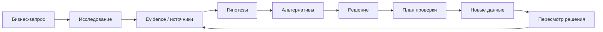
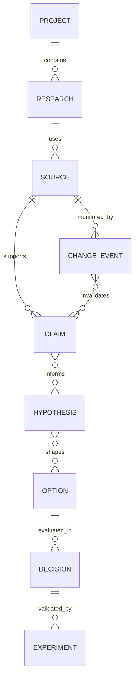

# Дополнение к исследованию: статьи, боли рынка, тренды, стартапы и лучшие практики

## Исполнительное резюме

В базовый отчёт стоит добавить отдельный слой **market intelligence**: не только «какие AI-технологии существуют», но и **какие проблемы уже достаточно велики, чтобы вокруг них возникли быстрорастущие компании, венчурные инвестиции и новые продуктовые категории**. Это особенно важно для проекта «Стратег Фабрики продуктов»: задание требует не технологической демонстрации, а инструмента, который помогает принимать проверяемые продуктовые решения, сравнивать альтернативы и возвращаться к ним при появлении новых данных. fileciteturn0file0

Главный рыночный сигнал 2025–2026 годов — переход от универсальных чат-ботов к **узким AI-системам, встроенным в конкретный рабочий процесс**. CB Insights насчитал более 170 стартапов AI-агентов уже в марте 2025 года и отмечал, что наиболее жизнеспособными становятся вертикальные и workflow-specific решения, а не просто ещё один чат-интерфейс. citeturn553294search0 В 2026 году LangChain также фиксирует, что research & data analysis входит в число самых распространённых реальных сценариев применения агентов, но основной барьер в production — уже не отсутствие моделей, а качество и надёжность результата. citeturn553294search3

Для МегаФона это означает, что выигрышная идея должна выглядеть не как «ChatGPT для продакт-менеджера», а как **система принятия продуктовых решений с доказательной базой**: она должна хранить источники, гипотезы, альтернативы, основания решения, состояние исследования и уметь пересматривать выводы после изменения вводных. Именно этот слой пока слабее всего закрыт большинством PM-инструментов и одновременно лучше всего совпадает с требованиями задания. fileciteturn0file0

## Какие боли рынка стоит добавить в отчёт

Ниже — боли, вокруг которых уже формируются продуктовые категории и инвестиционные кейсы.

| Боль | Что происходит на рынке | Почему важно для «Стратега» | Приоритет |
|---|---|---|---|
| Информация разбросана по документам, аналитике, встречам и web | Glean строит enterprise knowledge layer и в 2025 году был оценён в $7,2 млрд | Агенту нужен единый слой извлечения контекста, а не только web-search | Очень высокий |
| Рыночное исследование занимает много ручного времени | AlphaSense развивает AI market intelligence и в июне 2026 года оценён в $7,5 млрд; ARR превысил $600 млн по данным компании | Есть подтверждённый спрос на ускорение анализа рынков и компаний | Очень высокий |
| Поиск информации не равен исследованию | OpenAI BrowseComp показывает большой разрыв между простым browsing и многошаговым поиском с reasoning | Стратегу нужен исследовательский процесс, а не один поисковый запрос | Очень высокий |
| AI-ответам трудно доверять | В исследовании LangChain качество назвали ключевым production-барьером; observability используют чаще, чем полноценные evals | Проверяемость — самостоятельная функция продукта | Очень высокий |
| PM теряет время на сбор требований и артефактов | Рынок PM-agents дробится на feedback analysis, specs, meetings, workflow orchestration | Не стоит конкурировать только генерацией PRD | Высокий |
| AI-инструменты плохо встраиваются в существующий workflow | Исследования рынка PM-инструментов отмечают churn AI-native инструментов из-за качества, privacy и интеграции | Агент должен работать внутри файлов, репозитория и существующих инструментов | Высокий |
| Долгие исследования теряют контекст | Anthropic описывает потерю состояния между контекстными окнами как отдельную инженерную проблему | Persistence должен быть частью архитектуры, а не функцией чата | Очень высокий |

Сильный дополнительный аргумент даёт сам рынок enterprise AI. По оценке CB Insights, сегмент enterprise agents & copilots в 2025 году уже измерялся миллиардами долларов; особенно активно росли решения, которые автоматизируют конкретные рабочие процессы. citeturn553294search1 Это подтверждает важный продуктовый вывод: **ценность создаёт не “агентность” сама по себе, а автоматизация дорогого когнитивного workflow**.

Для телекомов эта проблема особенно актуальна. McKinsey в 2026 году отмечал, что большинство операторов уже экспериментирует с AI, однако только часть смогла масштабировать его между доменами; основная задача смещается от запуска пилотов к достижению измеримого эффекта и перестройке процессов. citeturn553294search7 Исследование McKinsey годом ранее также выделяло AI agents как одно из приоритетных направлений для telco, но подчёркивало необходимость масштабируемых данных, процессов и reusable AI capabilities. citeturn553294search8

## Единороги и стартапы, которые полезно разобрать

Это не прямые конкуренты одному продукту. Более полезно рассматривать их как **доказательство существования отдельных рыночных болей**.

| Компания | Какая боль решается | Что стоит перенять | Что не стоит копировать |
|---|---|---|---|
| **AlphaSense** | Дорогое market & competitive intelligence | Поиск по множеству источников, provenance, отраслевой контекст | Полный финансово-аналитический data moat невозможно повторить на хакатоне |
| **Glean** | Корпоративные знания находятся в десятках систем | Permission-aware retrieval, единый knowledge layer | Строить универсальный enterprise search |
| **Perplexity** | Пользователь хочет ответ с web-источниками, а не список ссылок | Source-first UX, iterative research | Делать ещё один универсальный поисковик |
| **Productboard** | Разрыв между feedback, приоритизацией и product roadmap | Связь evidence → insight → product decision | Сосредоточиться только на roadmap |
| **Hebbia** | Сложно анализировать большое количество документов одновременно | Matrix-style анализ множества источников по одинаковым вопросам | Пытаться строить отдельный spreadsheet-продукт |
| **ThriveAI и новые PM-agents** | PM перегружены повторяемой операционной работой | Delegation небольших задач агенту | Позиционировать агента как замену senior PM |

Glean в июне 2025 года привлёк $150 млн при оценке $7,2 млрд, что отражает сильный спрос на безопасный enterprise AI поверх внутренних источников знаний. citeturn189991search0 AlphaSense в июне 2026 года сообщил о раунде $350 млн при оценке $7,5 млрд и более $600 млн ARR; Reuters независимо подтвердил основные параметры раунда. citeturn189991search3turn189991news9 Это особенно важный прецедент для нашей задачи: рынок уже платит за **систематизацию информации для решений**, а не только за генерацию текста.

Productboard также важен как более близкий конкурентный ориентир. Компания достигла оценки $1,725 млрд ещё в 2022 году как платформа product management. citeturn189991search6 К 2025 году рынок начал двигаться дальше: Productboard перестраивал предложение вокруг специализированных AI-агентов для анализа feedback, подготовки спецификаций и работы с продуктовым контекстом. citeturn553294search5 Это создаёт стратегическую границу: **генерация PRD и анализ feedback быстро становятся commodity-функциями**, поэтому конкурсный проект следует дифференцировать через decision intelligence.

Отдельно стоит показать emerging-стартапы. ThriveAI, например, позиционирует агентов как «junior PM», которые собирают и организуют информацию, мониторят проблемы и забирают повторяемые задачи, оставляя стратегические решения человеку. Стартап привлёк $1,2 млн pre-seed. citeturn553294news14 Это не доказательство зрелого рынка, но хороший сигнал направления.

## Тренды, которые следует выделить сильнее

### От copilot к decision system

Наиболее важный тренд — AI перестаёт быть полем ввода «спросить что-нибудь». Новые продукты начинают **сохранять контекст работы, подключаться к инструментам, выполнять последовательности действий и формировать артефакты**, которые живут дольше одной сессии. CB Insights прямо связывает новую волну с AI-native workspaces, а не с добавлением чата в существующие продукты. citeturn553294search0

Для «Стратега» это означает, что основной объект системы — не чат, а:

### Research agent как самостоятельная категория

OpenAI BrowseComp показывает, что простое наличие браузера почти не решает сложные исследовательские задачи: важны стратегия поиска, многошаговое reasoning и умение менять поисковый путь. citeturn797687search5 Anthropic пришёл к похожей архитектуре в Research: центральный агент планирует исследование, а специализированные workers параллельно изучают отдельные направления. citeturn797687search4

**Вывод:** multi-agent нужен не потому, что он эффектно выглядит на презентации, а только там, где реально можно параллелить независимые исследовательские ветки.

### Observability и evals становятся частью продукта

В 2026 году 89% респондентов исследования LangChain сообщили об использовании observability в агентных системах, тогда как evals применялись заметно реже — около половины. Качество при этом осталось главным ограничением production-систем. citeturn553294search3 Для проекта МегаФона это даёт сильную возможность: **панель доказательности результата может быть важнее ещё одного агента**.

### Persistence становится отдельной инженерной компетенцией

Anthropic показал, что long-running agent без внешнего состояния начинает терять выполненную работу, повторять шаги или преждевременно объявлять задачу завершённой. Рабочий подход — хранить progress-файл, feature/state list и историю изменений вне контекстного окна. citeturn797687search2 Это почти идеально совпадает с требованием МегаФона продолжать работу после перерыва и пересматривать результат при новых данных. fileciteturn0file0

## Лучшие практики, которые стоит перенести в концепцию

Anthropic рекомендует начинать с максимально простой архитектуры и усложнять её только тогда, когда измерения показывают прирост качества; workflows лучше подходят для предсказуемых задач, а автономные агенты — для открытых и трудно формализуемых процессов. citeturn797687search0turn797687search1 Для хакатона это даёт гораздо более убедимую архитектуру, чем «оркестр из десяти агентов».

| Практика | Реализация в «Стратеге» | Что демонстрировать жюри |
|---|---|---|
| Evidence-first | Каждое существенное утверждение связано с источником | Нажатие на вывод → источник |
| Fact / Hypothesis / Forecast | Тип утверждения хранится явно | Агент не маскирует предположение под факт |
| Human checkpoint | Решение между альтернативами подтверждает PM | AI рекомендует, человек решает |
| Decision log | Причины выбора сохраняются | Почему вариант B победил A |
| Change impact analysis | Новые данные помечают затронутые выводы | «Источник изменился → пересчитаны 3 решения» |
| Persistent state | Research state хранится в файлах репозитория | Новая сессия продолжает работу |
| Evaluator step | Второй проход проверяет источники, противоречия, пропуски | До/после в eval |
| Cost routing | Простые этапы выполняет дешёвая модель | Стоимость выполнения одного кейса |
| Bounded autonomy | Лимиты итераций и инструментов | Агент не уходит в бесконечное исследование |

Особенно важен **evaluator-optimizer pattern**: Anthropic рекомендует его там, где критерии качества можно формализовать и результат реально улучшается после критики. citeturn797687search1 Для продукта это можно превратить в отдельного «редактора доказательности», который проверяет не стиль ответа, а ссылки, противоречия, достаточность данных и логический переход от evidence к recommendation.

## Какие новые продуктовые гипотезы следует добавить

Наиболее перспективны не новые самостоятельные продукты, а пять модулей внутри одной концепции.

| Гипотеза | Боль | MVP | Почему может стать «вау» |
|---|---|---|---|
| **Decision Memory** | Через месяц никто не помнит, почему приняли решение | `decisions.yaml` + связи evidence → hypothesis → decision | Агент способен объяснить историю решения |
| **Evidence Graph** | Исследование превращается в набор несвязанных ссылок | Граф утверждений и источников | Видна прочность каждого вывода |
| **Change Radar** | Стратегия быстро устаревает | Повторный запуск источников + diff | Агент сообщает, какие решения надо пересмотреть |
| **Strategy Challenger** | LLM склонен соглашаться с исходной гипотезой | Обязательный baseline, альтернативы и вариант «не делать» | Демонстрирует независимость анализа |
| **Research Quality Scorecard** | Пользователь не знает, насколько ответ надёжен | Coverage, source quality, contradiction flags | Даёт измеряемое качество, а не субъективный текст |

Именно **Evidence Graph + Decision Memory + Change Radar** образуют наиболее сильный moat концепции. Они напрямую соответствуют требованиям проекта и пока слабее выражены в массовых PM-agents, которые в основном концентрируются на документации, feedback и workflow automation. Сравнительный обзор PM-agents 2026 года показывает именно такую фрагментацию рынка: documentation, feedback intelligence, meetings и workflow orchestration уже превращаются в отдельные специализированные ниши. citeturn553294search4

Предлагаемая логическая модель может выглядеть так:

## Что это меняет в позиционировании конкурсного проекта

После добавления рыночного слоя я бы немного изменил центральный тезис проекта.

Не:

**«AI-агент, который помогает продакт-менеджеру делать исследования и стратегии».**

А:

**«Система продуктового decision intelligence: она собирает доказательства, строит альтернативы, фиксирует основания решений и автоматически показывает, какие выводы нужно пересмотреть при появлении новых данных».**

Такое позиционирование лучше объясняет отличие от ChatGPT, Perplexity, Productboard и обычного аналитического процесса. AlphaSense доказывает рыночную ценность глубокой intelligence-работы, Glean — ценность объединения корпоративного контекста, Productboard — спрос на workflow для PM, а исследования OpenAI и Anthropic показывают, какие архитектурные механизмы нужны для сложного поиска, контроля качества и долгоживущих агентов. citeturn189991search0turn189991search3turn189991search6turn797687search5turn797687search2

Для контекста самого МегаФона это тоже выглядит органично. В публичных материалах компании уже есть примеры применения AI к продуктовым и маркетинговым задачам: в частности, МегаФон описывал AI-помощника в рекламной платформе, где исследовательская и продуктовая команды анализировали клиентский путь и определяли этапы, на которых AI должен помогать пользователю. citeturn839989search2 Публичная Sandbox МегаФона также прямо ориентируется на B2C/B2B/B2G-продукты и требует от проектов понятной измеримой гипотезы. citeturn839989search14 Следовательно, акцент на **измеряемости решения, а не количестве AI-функций** хорошо согласуется и с публичным продуктовым контекстом компании.

Ключевой тезис для итогового отчёта стоит сформулировать так: **самая перспективная незакрытая ниша — не генерация стратегии, а управление доказательностью продуктового решения во времени**. Это делает проект менее похожим на очередного AI-PM и одновременно создаёт демонстрируемое преимущество: обычный чат может написать стратегию, но гораздо хуже поддерживает её происхождение, состояние, альтернативы, историю решений и контролируемый пересмотр. citeturn797687search2turn797687search5