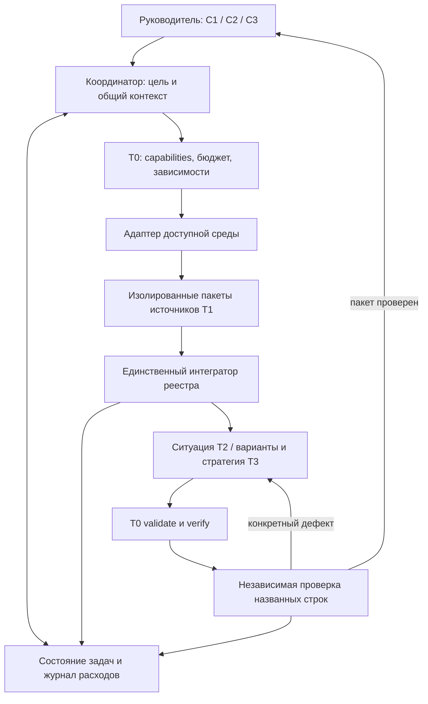

# Переносимый рой Стратега: что следует из ролика

## Главное

Рекомендация: сохранить одного владельца решения и реестра, подключать независимые исследовательские задания и отдельную проверку по риску.
Сам ролик предупреждает, что больше агентов не означает лучший результат; переносить нужно контракты, проверку и учёт полной цены.
Файл — русскоязычный разбор «Агентов Романа», а не установленная публикация Y Combinator; это видно по финальной заставке и вступлению.
Ниже предложен проект архитектуры. Он не реализован и не доказан сравнительным прогоном.

## Что за материал и чему здесь можно доверять

**Факт о файле V1:** в 01:15–02:26 рассказчик называет OpenAI DevDay в Токио, доклад *What Comes After Loops* и исследования Anthropic. На заставке 00:30 — «Главная проблема ИИ — 2026», на конечном кадре 32:36 — «Агенты Романа», `@RomanAgents`. Это идентификация канала и экранной темы; точное название публикации, исходный URL, имя физического автора и дата загрузки из файла не установлены. Оснований называть автором Y Combinator нет. См. [кадры](frames.md) и [метод](method.md).

YC действительно упоминается **внутри** разбора в 23:51–25:03 — как источник истории про 50 агентов в Minecraft, организацию ролей и провал снабжения. Поэтому описание пользователя имеет понятную связь с содержанием, но не устанавливает авторство всего ролика.

**Факты о содержании** ниже означают, что тезис произносится/показывается в ролике. Они не удостоверяют результаты пересказанных экспериментов. **Интерпретация** — связь тезиса со Стратегом; **предложение** — ещё не испытанное устройство системы. Источники D1–D9 и локальные основания R1–R6 перечислены в [sources.md](sources.md).

## Принципы и соответствие репозиторию

| Область | Что действительно есть в V1 | Что уже есть у Стратега | Что переносить / граница переноса |
|---|---|---|---|
| Роли и цель | 03:27–05:22: понятная измеримая цель, инструменты измерения, обратная связь. 10:21–13:29: Builder, Reviewer, Verifier имеют разные обязанности | R1/R2: восемь шагов; экстрактор возвращает кандидаты CLM, верификатор проверяет короткий список | Сохранить роли как ограниченные задания; «стратегия принята» не равна «текст написан». Верификатор продуктового решения проверяет основания и критерии, а не обещает рыночный успех |
| Независимость задач | 05:24–07:07: fan-out полезен, если агенты не мешают друг другу; при несогласованных зависимостях параллельность создаёт переделки | R2: отдельные источники, единая схема реестра; R6: отдельные worktree в разработке | Параллельно извлекать из независимых источников, проверять независимые утверждения. Общие ID/DEC/PRM и ранжирование вариантов интегрирует один владелец |
| Контекст | 07:07–08:44: дробление лишь ради старого ограничения контекста может мешать. 13:29–14:53: замечания выгодно возвращать первоначальному Builder, сохраняющему историю решений | R1: progress, brief, trace, impact; R2: продолжение по состоянию | Давать исполнителю компактный пакет входов; сохранять владельца до закрытия задания. Свежий контекст — для независимого ревью. Не копировать старые пороги 150K/400K как общие настройки всех моделей |
| Координация | 06:52–07:03: стабильные интерфейсы, зависимости. 17:43–19:39: главный поток собирает статусы; 20:43–21:45: постоянные руководители создают трудности согласования | R1/R2: workflow, validate, checkpoint; R6: точный scope и приёмка разработчиков | Ввести общий формат задания/результата и состояния DAG; межагентные разговоры нужны только для конкретной зависимости. Ночной процесс разработки не становится продуктовым runtime автоматически |
| Качество | 11:25–13:29: критерии до реализации; Reviewer смотрит дефекты, Verifier — реальный сценарий. 14:53–16:15: дополнительная проверка полезнее близ границы возможностей | R1/R2: validate → verify → decide → T1 сомнительного; C1–C3 и claim-verifier обязательны в предусмотренных точках | Дополнительные проверки выбирать по риску, обязательные gates сохранить. Согласие нескольких моделей не заменяет локатор/источник; автор не принимает собственную работу |
| Завершение | 12:29–13:09: сломанный сценарий возвращается исполнителю; 24:53–25:03 и 30:41–31:25: оценивать реальный результат, а не распределённые обязанности | R2: шаг закрывается после артефакта, validate и записи состояния | Различать submitted, verified, accepted; окончание генерации не означает успех. Исчерпание бюджета/таймаут — видимый неполный исход |
| Экономичность | 08:46–10:19: разные уровни мощности, консультация сильной модели, простая работа дешёвой; делегирование может съесть всю экономию | R3/R4: T0–T4, лестница effort, пакетные вызовы, cost; исторические накладные расходы изолированного CLI | Считать стоимость всего пути: план, dispatch, рабочие ответы, повторы, интеграция и ревью. Не переносить исторические ~25K токенов как константу. Много маленьких вызовов может быть хуже одного |
| Человек в контуре | 11:25–11:45: критерии до работы; 19:19–19:33: один собеседник вместо человека-курьера между агентами | R1/R2: человек подтверждает бриф, выбирает вариант, утверждает пакет | Один собеседник для человека и сохранённые C1–C3. Авторское обсуждение разработки не разрешает ИИ выбирать бизнес-вариант вместо руководителя |

### Что особенно важно не преувеличить

В 14:07–14:53 рассказчик сам ограничивает перенос сравнения возврата ошибки первоначальному Builder: около десяти PR, в конкретном эксперименте примерно 38% дешевле. Это аргумент проверить сохранение контекста у нас, а не прогноз экономии Стратега. Аналогично сравнение 266/21 уязвимостей во вступлении нельзя превращать в «рой в 13 раз лучше стратегирует».

В R4 уже есть более близкие к задаче измерения, чем демонстрация программной фабрики: пересмотр на T2 сохранял эталон при меньшей цене; отдельная дешёвая правка строк не снизила общую цену пересмотра. Значит, оптимизировать надо весь законченный сценарий. Эти исторические наблюдения ограничены учебными кейсами; они не являются новым контролируемым экспериментом этого задания.

**Существенная экранная оговорка, 27:35:** таблица 6,5 → 27 млн токенов и 21 → 266 находок сопровождается текстом, что примерно половина находок роя была вне основных директорий, а в сопоставимых директориях методы были близки по токенам на находку. [Сам кадр](frames/27-35.png) надёжнее искажённого ASR в 27:29–27:37. Из 12,7× по общему числу находок нельзя вывести ни эффект одной координации, ни превосходство при равном бюджете/области поиска.

В 22:15–23:43 описан поиск разных гипотез/контрпримеров командами с обменом находками, с отдельным предупреждением: исследовательская инфраструктура не равна доступному пользователю инструменту. В 27:41–29:13 автор объясняет пригодность независимого поиска и отличие от совместного изменения одного приложения. Для Стратега отсюда следует ограниченный fan-out исследовательских вопросов, а не десять тысяч одновременно пишущих стратегию агентов.

## Предлагаемая схема

**Предложение, без реализации.** Переносимый слой — контракты и сохранённое состояние; native subagents, CLI и UI — разные способы исполнения. Размер роя выбирается по задаче, а не по названию процесса.

Координатор хранит цель, условия C1, принятые решения и ссылки на evidence. Он не перечитывает все сырые рабочие журналы и не запускает другого руководителя на каждый раздел. Роль интегратора может выполнять тот же главный агент; важен единственный писатель, а не отдельная дорогостоящая модель.

### Контракт задания и результата

Предлагаемый task-пакет включает `task_id`, `run_id`, `attempt_id`, `baseline`, хэши входов, цель, роль, dependencies, область чтения/записи, запреты, точные входные локаторы, ожидаемую схему, criteria, лимит времени/токенов и способ отчёта. Модель, запрошенный/реальный effort, capabilities и разрешения фиксируются отдельно. Роль и стоимость модели — разные оси: T1 не получает право принять решение только потому, что он «эксперт».

Результат содержит статус, claims с цитатой/локатором и типом, неизвестное, созданные файлы и хэши, проверки и их фактические исходы, requested/resolved model, usage и ограничения. Длинные рассуждения не входят в общий переносимый отчёт. Если конкретному API нужна история reasoning для продолжения tool loop, она остаётся внутри адаптера и не теряется при его сериализации.

ID реестра выдаёт интегратор при принятии кандидатов. Рабочие агенты не записывают параллельно `claims.yaml`, `decisions.yaml`, `progress.md` или `run_log.md`; после каждой записи реестра интегратор запускает validate. Для задания на разработку — отдельные worktree; для извлечения данных — отдельные candidate-файлы и только разрешённые входы. Папка сама по себе не является технической песочницей.

### Планировщик и завершение

1. **Начало:** прочитать сохранённый шаг, применить действующие правила, получить профиль возможностей среды. Сначала T0; для известной задачи стартовый уровень — из routing, неизвестный маршрут записывается как неопределённый, без самовольной T4.
2. **Разделение:** распараллелить лишь независимые источники/вопросы с одинаковой рубрикой. Не отделять коммуникационное обещание от ещё не выбранного направления и не поручать нескольким авторам единую DEC. Если выгода dispatch неизвестна, начать одним исполнителем либо пакетным извлечением.
3. **Исполнение:** у каждого задания один владелец и ограниченная попытка. Состояния `queued → running → submitted → verified → accepted`; `failed/cancelled/blocked` — отдельные исходы с причиной. Повтор имеет новый attempt_id и тот же task_id.
4. **Исправление:** точный дефект возвращается владельцу с исходным заданием и замечаниями; ревьюер проверяет новую версию независимо. Проверки, прошедшие без затронувших их изменений, не повторяются. Проектные пределы двух исправлений перед эскалацией имеют приоритет над примером трёх раундов из V1.
5. **Потеря связи:** таймаут означает подозрение на остановку, не доказанную смерть. Не выдавать дублирующее право записи, пока старое выполнение не завершено или не лишено права принимать результаты; поздний ответ старой попытки отклоняется по attempt_id/версии входов. Для UI без такого контроля — остановка и явная передача человеку.
6. **Приёмка:** task accepted требует артефакта, совпадающего baseline, проверок и решения интегратора. Run готов к C3 только после всех обязательных заданий, общей согласованности и сохранения состояния. C1/C2/C3 завершаются только ответом человека; `awaiting_human` нельзя автоматически превратить в `accepted`.
7. **Продолжение:** новый процесс восстанавливает DAG и принятые результаты с диска, запускает только незавершённое; свежие сведения идут через существующие CHG/impact/supersede. Статусы модели не переписывают историю решений.

Взаимодействие по умолчанию — координатор ↔ исполнитель. Прямые сообщения между исполнителями включаются только при действительной зависимости и поддержке среды. Уведомления о старте не подменяют сообщения о результате; любой запуск должен иметь конечный исход либо видимый открытый gate.

## Реальная переносимость

Три уровня утверждений: **документировано** поставщиком, **локально наблюдалось** в этой сессии/историческом протоколе, **нужно испытать**. Профиль возможностей привязывается к версии приложения и провайдеру, не только к названию модели. Нельзя определить ZCode по CLAUDE-переменным или наличие native swarm — по слову Kimi.

| Среда / модель | Реалистичный адаптер | Что доказано и чего не обещаем |
|---|---|---|
| Codex | Native роли/потоки при доступных tools; запасной путь — существующий delegate через CLI | D1 и локальный exec help подтверждают настройки и структурированный вывод. Native-песочница наследуется; собственная роль не даёт другой sandbox. Конкретный хост может требовать отдельного режима для выбора модели. Этот worker не создавал новых агентов |
| Claude Code | `.claude/agents` для существующих ролей, native subagents; CLI по подтверждённому help/транспорту | D2; definitions уже есть в R2. Agent teams — отдельная, необязательная возможность. Локальный wrapper заблокирован проверкой VPS-транспорта, поэтому unattended-работа здесь не подтверждена; не обходить блокировку |
| ZCode + GLM | Native general-purpose/Explore; custom roles Beta лишь после проверки установленной версии; UI-последовательность как fallback | D3 подтверждает новые custom model/effort/tools, R5 — более старый UI-прогон с одной моделью. Не объявлять ни «ZCode всегда только UI», ни «у установленной версии уже работает model-per-worker». Generic zcode CLI backend в контракте delegate не заявлен |
| Cursor | Native subagents/isolated project copies по D4; SDK/CLI — отдельный адаптер после локальной проверки | Новая документация поддерживает больше, чем R3. Доступность на машине и аккаунте неизвестна. Рабочий режим picker/current остаётся допустимым без имитации параллельного запуска |
| DeepSeek | Модель через уже разрешённый host/provider или проверенный локальный сервер; существующий selfhosted-контракт — для текстовых задач | D6: сохранить reasoning_content в tool loop. По R3/WORK_LOG имеющийся selfhosted delegate описан **без инструментов**; он не заменяет полноценный агентный runtime. Бесплатная квота и доступность модели не гарантированы |
| Kimi | Модель в проверенном host либо текстовый runner; самостоятельный agent SDK — отдельная интеграция, не часть минимального переноса | D7: effort зависит от серии, K3 имеет default max, что конфликтует с автоматическим запуском без согласия; нужно явно поддерживаемое значение. Не обещать встроенный swarm/веб-доступ на основании API-модели |
| Qwen | Локальный/разрешённый hosted inference для кандидатов, общая task/result schema; инструменты и агенты обеспечивает host | D8: режимы зависят от точного ID/шаблона сервера. Qwen3-Instruct-2507 и Thinking-2507 нельзя одинаково переключать `/no_think`. Локальная модель не равна установленной безопасной среде исполнения |

Профиль возможностей: `native_subagents`, `per_worker_model`, `per_worker_effort`, `isolated_context`, `isolated_writes`, `structured_result`, `cancel`, `resume`, `usage`, `headless`, `tool_loop`. Для каждого поля нужны `supported/unsupported/unknown`, версия, источник/команда проверки и дата. Документация даёт кандидата профиля, короткий разрешённый smoke-тест — подтверждение. `unknown` не преобразуется в `true`.

Существующие `delegate.py`, `ledger.py`, `verify.py`, `decide.py`, схемы и workflow переиспользуются как контракты. Прежде чем добавлять новый orchestrator, нужно проверить, чего именно не хватает этим контрактам; данное исследование не утверждает наличие нового универсального scheduler, отмены, lease-механизма или надёжного resume в текущем коде.

## Критерии приёмки следующей реализации

Это предложенная проверяемая рубрика, не результаты испытаний. Нужны локальные фикстуры без платных вызовов, а затем отдельно разрешённые живые прогоны.

| Проверка | Наблюдаемое условие успеха |
|---|---|
| Изоляция и provenance | Два задания получают разные наборы источников; кандидаты указывают существующий локатор и хэш входа; за пределами разрешённой области нет изменений |
| Единственный писатель | Параллельные кандидаты не создают дубли ID, потерянные записи или запись DEC исполнителем; validate после каждого принятия без ошибок |
| Зависимости | Стратегия/PRM не принимаются раньше выбранной DEC; изменение основания помечает только затронутые задачи и результаты устаревшими |
| Независимая проверка | Ревьюер не получает право принимать собственную работу; намеренно неверное число/подменённый локатор не проходят даже при «уверенном» ответе автора |
| Человек | Сценарии на C1, C2, C3 сохраняют awaiting_human; перезапуск не выдумывает подтверждение; DEC.chosen совпадает с ответом роли человека |
| Реальное завершение | Ошибка, таймаут и исчерпанный бюджет не дают success; поздний ответ старой попытки не перезаписывает принятую версию; итог перечисляет незакрытые gates |
| Восстановление | Остановить run после принятия части источников; продолжить с диска без повторной регистрации/оплаты уже принятых заданий; открытые задания остаются видны |
| Неравные среды | Один и тот же task/result пакет проходит через fixture native, CLI и UI/manual; unsupported capability выбирает честный fallback, а не неизвестную команду |
| Границы инструментов | Текстовый selfhosted runner не исполняет tool calls; инструментальный адаптер сохраняет необходимые поля истории конкретного провайдера; неверный параметр возвращается как ошибка |
| Полная цена | Учтены tokens/cache/dispatch/review/retries/integration всех участников; неизвестные расходы явно отделены от нуля, стоимость считается существующим cost-контрактом |
| Польза роя | На одинаковых разрешённых материалах сравнить solo, пакетный fan-out и автор+проверяющий: поддержка утверждений, критические ошибки, полнота неизвестного, время до C3, полная цена и лишние остановки человека. Порог/бюджет фиксировать до прогона; победитель не определяется числом агентов |

Начальный объём реализации — контракт задания/результата, честный capability profile, один native/CLI путь и последовательный fallback. Затем один сценарий независимого извлечения и один сценарий проверки/возврата владельцу. Постоянные департаменты, агентные сообщества, самосоздание ролей и универсальный «роевой» транспорт не нужны для доказательства первой пользы.

## Что не переносить буквально

- Числа из программных/исследовательских примеров — как прогноз качества стратегии, цену будущего запуска или универсальные размеры команды.
- Топологию IT-компании с бесконечными менеджерами — как замену предметной декомпозиции источников и решений.
- Изоляцию контекста — как гарантию независимости выводов или безопасности записи; одинаковые источники/модель могут давать коррелированные ошибки.
- Браузерную проверку работающей регистрации — как доказательство спроса, эффекта пилота или валидности бизнес-решения. Здесь Verifier проверяет основание и план, эффект позже измеряет EXP.
- Прогноз автора о будущих возможностях моделей — как доступную функцию текущей среды.
- Опциональное сокращение проверки на простой задаче — как разрешение удалить C1–C3, validate или обязательную проверку перед C3.

## Ограничения и статус

Видео обработано локальным ASR; профессиональная дословная сверка на слух не выполнена, имена и англоязычные термины распознаются хуже. Все таймкоды — локаторы исходного файла, не отдельные измерения эффективности. Внешние первичные исследования, пересказанные рассказчиком, в этом задании не воспроизводились. Официальные docs проверены, но живые запуски предлагаемых адаптеров и сравнительная оценка роя не выполнялись. Код, проекты `projects/`, конфигурация моделей, приложения и чужие временные данные не менялись; детали покрытия и поиска прежнего разбора — в [method.md](method.md).
